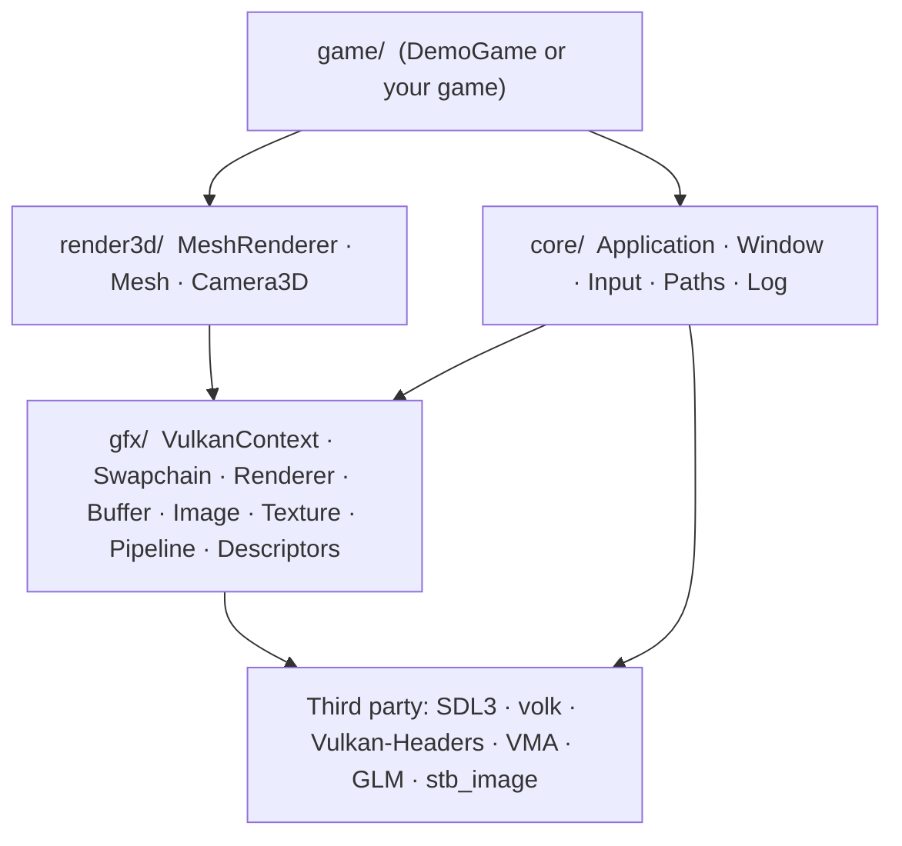
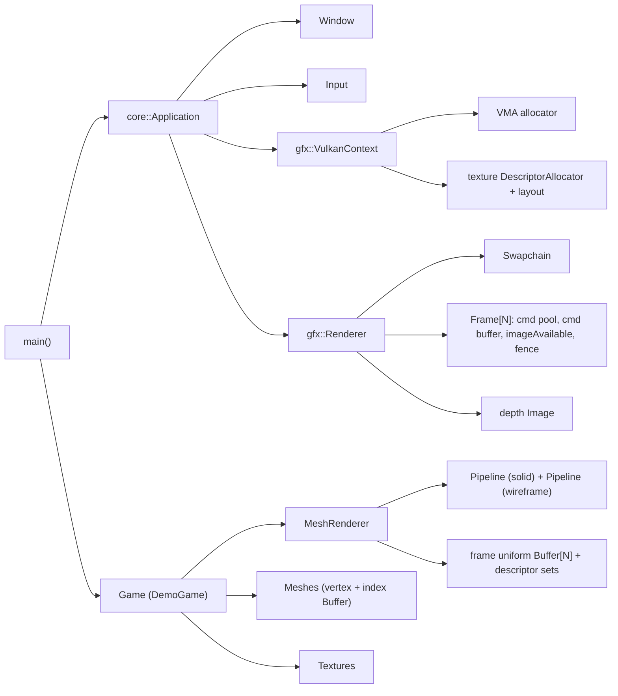
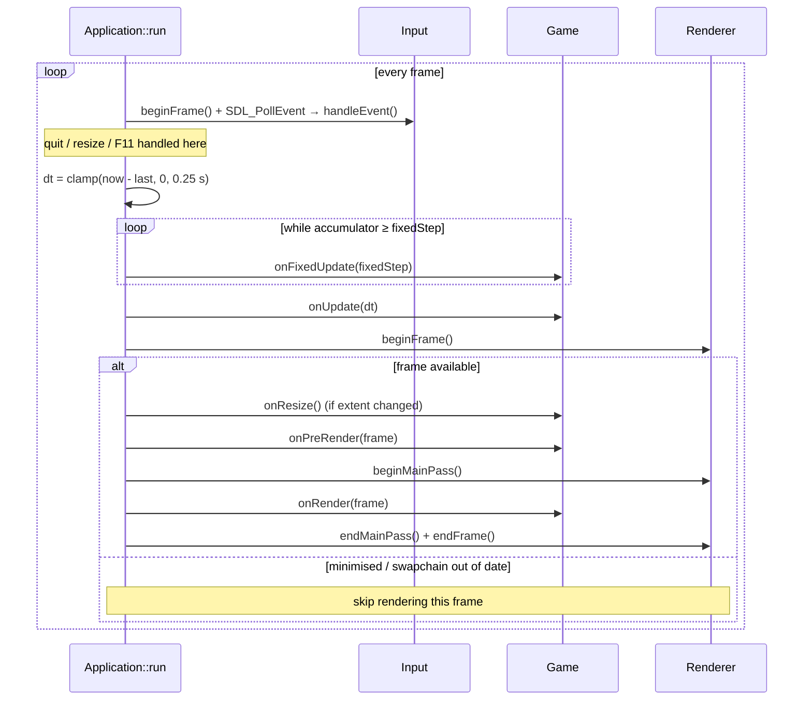
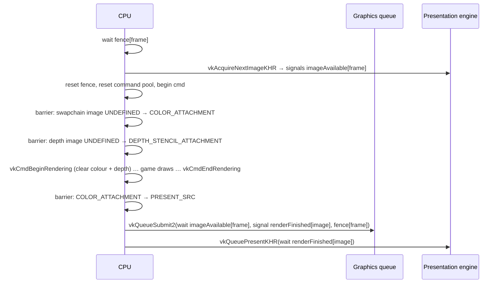
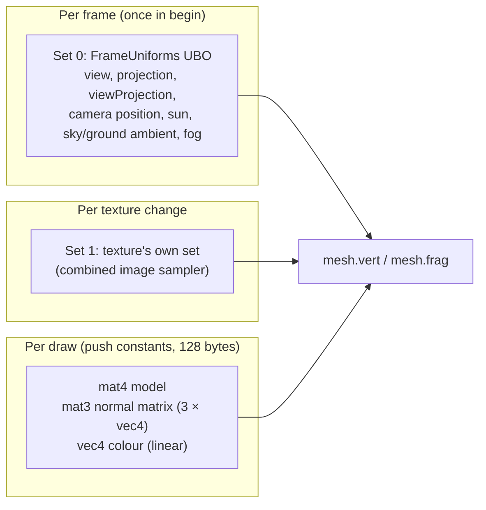
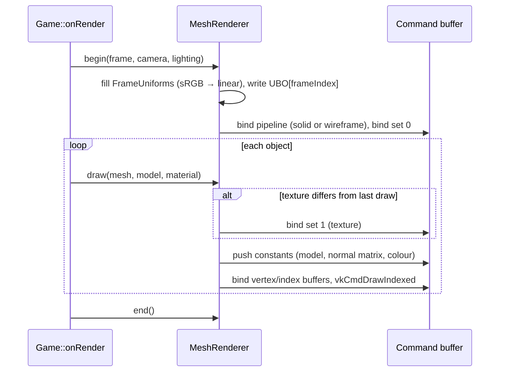
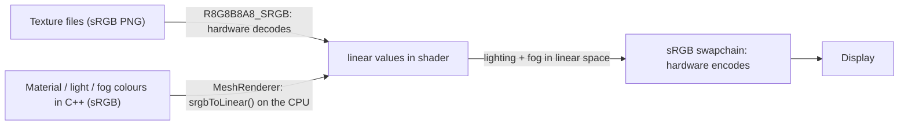

# Game3D — Architecture Overview

> Status: describes the framework as of version 0.1.0.
> Audience: anyone extending the framework or building a game on top of it.
> Diagrams use [Mermaid](https://mermaid.js.org/); they render on GitHub/GitLab and in
> VS Code with the *Markdown Preview Mermaid Support* extension.

---

## 1. Purpose and design goals

Game3D is a minimal, engine-free foundation for 3D games written in C++20, targeting
**Windows, Linux and Steam Deck** with **Vulkan 1.3** for graphics.

| Goal | How it is achieved |
|---|---|
| You own and understand all the code | Small codebase (~4k lines including comments), no engine or framework; only thin, well-known libraries |
| Cross-platform from day one | SDL3 hides OS differences; no platform `#ifdef`s in game code |
| Modern, simple Vulkan | Vulkan 1.3 *dynamic rendering* (no render passes / framebuffers) and *synchronization2* |
| Hard to misuse | RAII, move-only wrappers for every GPU object; fatal errors are loud and descriptive |
| Fast iteration | Shaders and assets rebuild/copy automatically; new source files are picked up by CMake |
| Shippable | Static SDL3, Vulkan loaded at runtime, executable finds its files relative to itself |

Non-goals: being a general-purpose engine, an editor, a scene graph, or an ECS. Those are
decisions for the game built on top.

---

## 2. Layered structure

The code is split into four layers. Each layer only depends on the layers below it.



| Layer | Namespace | Responsibility | Shared with Game2D |
|---|---|---|---|
| `src/core` | `core` | Program lifetime, main loop, window, input, file paths, logging | Yes, identical |
| `src/gfx` | `gfx` | Everything Vulkan: device, swapchain, frames, memory, textures, pipelines | Yes, identical |
| `src/render3d` | `render3d` | 3D-specific rendering on top of `gfx` | No |
| `src/game` | (global) | The actual game; replaceable | No |

> `core` and `gfx` reference each other in one place only: `Application` owns the
> `VulkanContext` and `Renderer`, and `Window` creates the Vulkan surface. `gfx` itself
> depends only on `core::Window` (for the surface/size) and `core/Log.h`.

### Source map

```
src/
  main.cpp                    builds AppConfig, creates Application + Game, runs
  core/
    Application.h/.cpp        Game interface, AppConfig, main loop, fixed timestep
    Window.h/.cpp             SDL window, pixel size, fullscreen, Vulkan surface
    Input.h/.cpp              keyboard / mouse / gamepad state per frame
    Paths.h/.cpp              basePath(), shaderPath(), assetPath()
    Log.h                     LOG_* macros, core::fatal()
  gfx/
    VkCommon.h                single Vulkan include (vulkan.h + volk + VMA), VK_CHECK
    Implementations.cpp       VMA and stb_image implementation units
    VulkanContext.h/.cpp      instance, debug messenger, GPU selection, device, VMA
    Swapchain.h/.cpp          swapchain + image views + per-image semaphores
    Renderer.h/.cpp           frames in flight, acquire/submit/present, main pass
    Buffer.h/.cpp             VkBuffer + VMA allocation
    Image.h/.cpp              VkImage + view, imageBarrier() helper
    Texture.h/.cpp            Image + sampler + descriptor set, mip generation
    Pipeline.h/.cpp           Pipeline (RAII) + PipelineBuilder, SPIR-V loading
    Descriptors.h/.cpp        layout builder, growable allocator, writer
  render3d/
    Camera3D.h/.cpp           perspective camera (yaw/pitch, Vulkan clip conventions)
    Mesh.h/.cpp               Vertex, MeshData, primitives::cube/plane/sphere, GPU Mesh
    MeshRenderer.h/.cpp       lit, textured forward renderer; Material, SceneLighting
  game/
    DemoGame.h/.cpp           example scene with a fly camera
shaders/                      GLSL sources (compiled to SPIR-V at build time)
  common.glsl                 shared uniform / push-constant declarations (include)
  mesh.vert, mesh.frag        the mesh shaders
assets/                       runtime data (copied next to the executable)
cmake/                        Dependencies.cmake, Shaders.cmake
```

---

## 3. Module reference

### 3.1 core

**`core::Application`** owns every long-lived system and runs the main loop.
Construction order (and reverse destruction order) is significant:

1. `SDL_Init(VIDEO | GAMEPAD)`
2. `Window` → 3. `Input` → 4. `gfx::VulkanContext` → 5. `gfx::Renderer`

Its destructor tears down in exactly the reverse order, then calls `SDL_Quit()`.

**`core::Game`** is the interface a game implements. Every hook is optional:

| Hook | When | Typical use |
|---|---|---|
| `onInit` | once, after the GPU is ready | load textures, create meshes and `MeshRenderer`, set up state |
| `onFixedUpdate(dt)` | 0..n times per frame at a fixed rate (default 60 Hz) | gameplay simulation, physics |
| `onUpdate(dt)` | once per frame, real frame time | input handling, camera, animation |
| `onPreRender(frame)` | before the main render pass begins | uploads, off-screen passes, compute |
| `onRender(frame)` | inside the main pass (cleared, viewport set) | draw calls |
| `onResize(w, h)` | swapchain size changed | resize render targets / UI |
| `onShutdown` | after `vkDeviceWaitIdle`, before teardown | destroy GPU resources |

**`core::AppConfig`** groups configuration: window description, `gfx::RendererConfig`,
fixed timestep, validation on/off, FPS-in-title and fullscreen hotkeys.

**`core::Window`** wraps `SDL_Window` (created with `SDL_WINDOW_VULKAN |
SDL_WINDOW_HIGH_PIXEL_DENSITY`). It reports the *pixel* size (high-DPI aware), supplies
the Vulkan instance extensions SDL needs, and creates the `VkSurfaceKHR`.
Fullscreen is borderless "desktop" fullscreen (what gamescope on the Deck expects).

**`core::Input`** turns SDL events into per-frame state:

- `down` / `pressed` / `released` for keys (by scancode, layout-independent), mouse
  buttons and gamepad buttons. Presses are latched from events, so a tap shorter than a
  frame is never lost.
- Mouse position/delta in framebuffer pixels, wheel, relative mouse mode.
- First connected gamepad, with hot-plug fallback; radial dead zone on sticks; triggers
  0..1; rumble. Steam Deck controls arrive as a standard gamepad through Steam Input.
- Keys and buttons are released on focus loss to avoid "stuck" input.

**`core::Paths`** resolves everything relative to the executable directory
(`SDL_GetBasePath()`): `shaderPath("x.vert.spv")` → `<exe>/shaders/…`,
`assetPath("textures/x.png")` → `<exe>/assets/…`. The working directory never matters.

**`core/Log.h`** maps `LOG_INFO/WARN/ERROR/DEBUG` onto SDL's logger and provides
`core::fatal(fmt, …)`, which logs, shows a message box and aborts (see §9).

### 3.2 gfx

**`gfx::VulkanContext`**: one per application.

- Loads Vulkan at runtime through **volk** (`volkInitialize`); nothing links against
  `vulkan-1.dll` / `libvulkan.so`.
- Creates the instance (API 1.3), optionally with `VK_LAYER_KHRONOS_validation` and a
  `VK_EXT_debug_utils` messenger.
- Picks a GPU: must support Vulkan 1.3, `VK_KHR_swapchain`, `dynamicRendering`,
  `synchronization2`, and graphics + present queues. Scores discrete > integrated and
  prefers a single queue family for both.
- Creates the device (enables anisotropy and `fillModeNonSolid` when available) and the
  **VMA** allocator.
- Provides `immediateSubmit(lambda)` for blocking, load-time GPU work (uploads).
- Owns the shared **texture descriptor set layout** (binding 0 = combined image sampler,
  fragment stage) and a growable, free-able `DescriptorAllocator` for texture sets.

**`gfx::Swapchain`**: creation and recreation of the swapchain, its image views and
one *render-finished* semaphore **per swapchain image**.

- Format: `B8G8R8A8_SRGB` / `R8G8B8A8_SRGB` with sRGB non-linear colour space.
- Present mode: FIFO when vsync is on; otherwise MAILBOX → IMMEDIATE → FIFO.
- Image count: at least 3 (triple buffering), clamped to the surface limits.

**`gfx::Renderer`**: the frame loop on the GPU side (details in §5).
Configured by `RendererConfig { vsync, depthBuffer, clearColor, framesInFlight }`.
Game3D uses `depthBuffer = true`: the renderer then owns a depth image (see §5.3).

**`gfx::Buffer`**: `VkBuffer` + `VmaAllocation`. `MemoryUsage::GpuOnly`,
`CpuToGpu` (persistently mapped, sequential write) or `GpuToCpu` (mapped, cached).
`Buffer::createWithData()` uploads via a staging buffer. `write()` / `flush()` for
mapped buffers.

**`gfx::Image`**: `VkImage` + view + allocation for textures and render targets.
`imageBarrier()` records a single sync2 image barrier/layout transition.

**`gfx::Texture`**: a sampled RGBA8 image with its own sampler and **its own
descriptor set**, so a texture can be bound with a single call and needs no lookup tables.
Created from pixels (`fromPixels`), from a file via stb_image (`fromFile`) or as a solid
colour (`solid`). `TextureDesc` selects sRGB vs UNORM, mipmaps (generated on the GPU by
blitting), filtering and wrap mode. Linear filtering with mipmaps also enables
anisotropic filtering (up to 16×) when the GPU supports it, which keeps ground
textures sharp at grazing angles.

**`gfx::Pipeline` / `gfx::PipelineBuilder`**: fluent builder for graphics pipelines
using dynamic rendering (`VkPipelineRenderingCreateInfo` with attachment formats).
Viewport and scissor are always dynamic state. Blend modes: `Opaque`, `Alpha`,
`PremultipliedAlpha`, `Additive`.

**`gfx::Descriptors`**: `DescriptorLayoutBuilder`, `DescriptorAllocator` (adds a new pool
whenever the current one is exhausted; optional per-set freeing) and `DescriptorWriter`
(batches `vkUpdateDescriptorSets`).

### 3.3 render3d

**`render3d::Camera3D`**: perspective camera.

- Right-handed world, **+Y up**, looks down **−Z** by default (`yaw = −π/2`).
- `position`, `yaw`, `pitch` (radians), `fovY` (default 60°), `nearPlane` (0.1),
  `farPlane` (500), aspect via `setAspect()`.
- `forward()` / `right()` / `up()` basis vectors, `lookAt(target)`.
- `projection()` follows Vulkan conventions: depth range [0, 1] (GLM is built with
  `GLM_FORCE_DEPTH_ZERO_TO_ONE`) and Y flipped (`proj[1][1] *= -1`) so +Y is up on screen.

**`render3d::Mesh` and `MeshData`**

- `Vertex { vec3 position; vec3 normal; vec2 uv; }` (32 bytes).
- `MeshData` = vertices + `uint32` indices, triangles **counter-clockwise** seen from the
  front.
- `primitives::cube(size)` (24 vertices, per-face normals/UVs), `plane(size, uvRepeat)`
  (XZ plane facing +Y), `sphere(radius, segments, rings)`.
- `Mesh` uploads `MeshData` into **device-local** vertex and index buffers once (via
  staging) and draws itself with `draw(cmd)`: bind buffers + one `vkCmdDrawIndexed`.

**`render3d::MeshRenderer`**: forward renderer for lit, textured meshes (details in §6).
API: `begin(frame, camera, lighting)`, `draw(mesh, modelMatrix, material)`, `end()`,
`setWireframe(bool)`, `drawCalls()`.

- `Material { const Texture* texture; vec4 color; }`: texture may be `nullptr`
  (an internal 1×1 white texture is used); `color` is an sRGB tint.
- `SceneLighting`: sun direction/colour/intensity, sky and ground ambient colours with an
  ambient intensity, fog colour and density. All colours are sRGB.

---

## 4. Object ownership and lifetime



Rules:

- **All GPU wrappers are RAII and move-only** (`Buffer`, `Image`, `Texture`, `Pipeline`).
  They hold a pointer to the `VulkanContext` and destroy themselves in their destructor.
- In `main()`, the `Application` is declared before the `Game`, so the game (and every
  GPU object it owns) is destroyed first, while the device still exists.
- `Application::run()` calls `vkDeviceWaitIdle` before `onShutdown`, so destroying
  resources there or in the game's destructor is safe.
- **During gameplay**, destroying a resource that an in-flight frame may still use is an
  error. Call `renderer.waitIdle()` first, or keep resources alive for
  `framesInFlight` frames. (A deferred-deletion queue is a natural future addition.)
- In debug builds, VMA asserts at shutdown if any `Buffer`/`Image` leaked.

---

## 5. Main loop and frame lifecycle

### 5.1 CPU timeline



- **Fixed timestep with interpolation.** Simulation runs at `AppConfig::fixedTimestep`
  (1/60 s). `interpolationAlpha()` (0..1) tells how far the real time is between the last
  two fixed steps; render `mix(previousState, currentState, alpha)` for smooth motion on
  any refresh rate (144 Hz, 40 Hz Deck mode…). `DemoGame` does this for its animation
  (spin and bobbing); the fly camera is moved in `onUpdate` for the lowest input latency.
- `dt` is clamped to 0.25 s so a breakpoint or hitch doesn't cause a spiral of catch-up.
- When minimised the loop sleeps and resets the clock instead of rendering.

### 5.2 GPU frame (Renderer)



**Synchronisation objects**

| Object | Count | Purpose |
|---|---|---|
| Fence `inFlight` | per frame in flight (2) | CPU waits before reusing that frame's command buffer and per-frame buffers |
| Semaphore `imageAvailable` | per frame in flight | acquire → rendering may start writing the image |
| Semaphore `renderFinished` | **per swapchain image** | rendering done → presentation may read the image |
| Command pool + buffer | per frame in flight | reset as a whole each frame (cheap) |

`renderFinished` is per *image*, not per frame, because the presentation engine may still
hold a semaphore after the frame's fence signals; tying it to the image guarantees it is
not reused too early.

**Swapchain recreation** is triggered by a pixel-size change event, `VK_SUBOPTIMAL_KHR`
/ `VK_ERROR_OUT_OF_DATE_KHR` from acquire or present, or a vsync toggle. It waits for the
device to go idle, then recreates the swapchain (passing the old one as `oldSwapchain`) and
the depth buffer, if any. Simple and robust; resizing is rare enough that the idle wait does
not matter.

`FrameContext` is what the game receives: `cmd`, `frameIndex` (index your per-frame
resources with it), `imageIndex`, `frameNumber` and `extent`.

### 5.3 Depth buffer

- Format: the first of `D32_SFLOAT`, `D16_UNORM` that supports depth attachments
  (`D32_SFLOAT` on every desktop GPU and the Deck).
- **One** depth image is shared by all frames in flight. That is safe because every frame
  starts with a barrier from `LATE_FRAGMENT_TESTS / DEPTH_WRITE` (the previous frame's
  writes) to `EARLY|LATE_FRAGMENT_TESTS / DEPTH_READ|WRITE`, and both frames run on the same
  queue.
- Layout `DEPTH_STENCIL_ATTACHMENT_OPTIMAL`, cleared to **1.0** each frame, store op
  `DONT_CARE` (depth is not needed after the frame). Pipelines use compare `LESS`.
- Recreated together with the swapchain on resize.

> If you add a post-process that needs depth (SSAO, fog from depth, soft particles), change
> the store op to `STORE` and add `SAMPLED` to the image usage.

---

## 6. Mesh rendering

### 6.1 Data bound per draw



| Binding | Contents | Update frequency |
|---|---|---|
| Set 0, binding 0 (UBO, vertex + fragment) | `FrameUniforms`: matrices, camera position, lights, fog (std140) | once per frame, written into that frame's own buffer |
| Set 1, binding 0 (sampler, fragment) | material texture | when the texture changes between draws |
| Push constants (vertex + fragment) | model matrix, normal matrix, colour | every draw |

- The push-constant block is **exactly 128 bytes**, the minimum every Vulkan GPU must
  support, so it works everywhere without querying limits. A `static_assert` protects it.
- The **normal matrix** (`transpose(inverse(mat3(model)))`) is computed on the CPU so
  normals stay correct under non-uniform scaling; it is passed as three `vec4` columns to
  match std430 padding.
- **Per-frame uniform buffers**: one host-visible UBO and descriptor set per frame in
  flight, so writing this frame's camera never races with the GPU reading last frame's.
- Redundant texture binds are skipped (`boundTexture_`). Sorting draws by texture reduces
  binds further.

### 6.2 Draw flow



### 6.3 Pipeline state

| State | Solid pipeline | Wireframe pipeline |
|---|---|---|
| Polygon mode | `FILL` | `LINE` (only created if `fillModeNonSolid` is supported) |
| Culling | back faces, front = counter-clockwise | none |
| Depth | test + write, `LESS` | test + write, `LESS` |
| Blending | opaque | opaque |
| Vertex input | binding 0: position (`R32G32B32`), normal (`R32G32B32`), uv (`R32G32`) | same |

### 6.4 Shading model (`mesh.frag`)

```
albedo   = texture(uv) · material colour
N        = normalize(normal)   (flipped for back faces, e.g. in wireframe)
ambient  = mix(groundColour, skyColour, N.y · 0.5 + 0.5)      hemisphere light
diffuse  = sunColour · max(N·L, 0)                              Lambert
specular = sunColour · 0.25 · max(N·H, 0)^64                    Blinn-Phong
colour   = albedo · (ambient + diffuse) + specular
fog      = 1 − exp(−(density · distance)²)                     exponential-squared
output   = mix(colour, fogColour, fog)                          linear, sRGB-encoded by the swapchain
```

The clear colour is set to the (linearised) fog colour, so distant geometry fades smoothly
into the background. Shared declarations live in `shaders/common.glsl`, included by both
stages with `GL_GOOGLE_include_directive`.

---

## 7. Coordinate systems and colour

**World space**: right-handed, **+Y up**, +X right, the default camera looks along **−Z**.
Units are arbitrary; the demo treats 1 unit as 1 metre.

**Winding**: front faces are **counter-clockwise** in object space. Vulkan's framebuffer has
+Y down, and `Camera3D::projection()` flips Y, which keeps counter-clockwise triangles
front-facing with `VK_FRONT_FACE_COUNTER_CLOCKWISE`.

**Transform chain**

```
clip = projection · view · model · position
view       = lookAt(position, position + forward, +Y)
projection = perspective(fovY, aspect, near, far) with [1][1] negated (Y flip),
             depth 0 at near plane, 1 at far plane
```

**Camera orientation**

```
forward = (cos(pitch)·cos(yaw), sin(pitch), cos(pitch)·sin(yaw))
right   = normalize(forward × +Y)
up      = right × forward
```

Pitch should be clamped just short of ±90° (the demo uses ±1.55 rad) to avoid the
`lookAt` singularity.

**Colour pipeline (linear workflow).**



Rule of thumb: **author colours in sRGB** (as picked in an image editor); **lighting runs
in linear space**, which is what makes it look physically plausible. Data textures (normal
maps, roughness, masks) must use `TextureDesc::srgb = false`.

---

## 8. Build system

**CMake ≥ 3.22**, presets in `CMakePresets.json` (`debug`, `relwithdebinfo`, `release`,
`vs2022`, `vs2026`).

**Dependencies** are fetched by `cmake/Dependencies.cmake` with pinned versions:

| Library | Version | Use | Linked as |
|---|---|---|---|
| SDL3 | 3.4.16 | window, input, gamepads | static |
| Vulkan-Headers | SDK 1.4.350.0 | Vulkan types | headers |
| volk | SDK 1.4.350.0 | runtime Vulkan loader | compiled into `third_party` |
| VMA | 3.3.0 | GPU memory allocation | header (impl in `Implementations.cpp`) |
| GLM | 1.0.1 | vector/matrix math | headers |
| stb | pinned commit | image loading | header (impl in `Implementations.cpp`) |

Global definitions: `VK_NO_PROTOTYPES`, `GLM_FORCE_DEPTH_ZERO_TO_ONE`,
`GLM_FORCE_RADIANS`.

**Shaders** (`cmake/Shaders.cmake`): every `shaders/*.vert|*.frag|*.comp` is compiled to
`<exe dir>/shaders/<name>.spv` with `glslc` or `glslangValidator` (from the Vulkan SDK or
system packages). If neither exists, glslang is downloaded and built from source
automatically. `*.glsl` files in the folder are treated as includes and trigger rebuilds.

**Output layout**: `build/<preset>/bin/<Config>/` contains the executable, `shaders/` and
`assets/` (re-synced on every build). `cmake --install` produces a distributable folder.

---

## 9. Error handling, logging and debugging

- **Philosophy: fail fast and loud.** Unrecoverable conditions call `core::fatal()`,
  which logs, shows a message box (useful for players: "No GPU with Vulkan 1.3 support")
  and aborts.
- `VK_CHECK(expr)` wraps Vulkan calls and reports the result name, the expression and
  file:line.
- **Validation layers** are enabled in Debug builds when installed; override with the
  environment variable `GAME_VALIDATION=0/1`. Messages of warning level and above are
  routed to the log.
- **Debug names** are attached to buffers, images and views via `VK_EXT_debug_utils`, so
  RenderDoc / Nsight / validation messages show readable names.
- **Testing aid:** `GAME_MAX_FRAMES=N` exits after N rendered frames (smoke tests, CI).

---

## 10. Platform notes

| Platform | Notes |
|---|---|
| Windows | MSVC (VS 2022/2026), console in Debug, `WIN32` subsystem in the `release` preset (`GAME_WINDOWS_CONSOLE=OFF`). Vulkan SDK recommended for validation. |
| Linux | X11 and Wayland via SDL3 (dev packages needed at build time only). `$ORIGIN` rpath for shipping extra `.so` files. |
| Steam Deck | SteamOS + Mesa RADV (full Vulkan 1.3). 1280×800; controls exposed as a gamepad by Steam Input; borderless fullscreen under gamescope. Build in a container (distrobox) or the Steam Linux Runtime SDK for releases. |

---

## 11. Extending the framework

| You want to… | Where / how |
|---|---|
| Write your game | New `core::Game` subclass in `src/game/`, construct it in `main.cpp` |
| Add a shader | Drop `foo.vert` / `foo.frag` in `shaders/`, build a pipeline with `PipelineBuilder` using `core::shaderPath("foo.vert.spv")` |
| Add your own geometry | Fill `render3d::MeshData` (CCW triangles, normals, UVs) and construct a `Mesh` |
| Load models | Add a glTF loader (cgltf / fastgltf) that produces `MeshData` + `Texture`s |
| Add a new renderer (skybox, particles, instancing) | New class in `render3d/` following `MeshRenderer`: own `Pipeline` with `renderer.depthFormat()`, per-frame buffers indexed by `frame.frameIndex` |
| Shadows | Depth-only `Image` + pipeline rendered from the sun in `onPreRender`; sample it in `mesh.frag` |
| Render off-screen (post-processing, bloom, tone mapping) | Create an `Image` with `COLOR_ATTACHMENT \| SAMPLED` usage, render to it in `onPreRender`, sample it in the main pass |
| Change GPU features | Feature chain in `VulkanContext::createDevice()` |
| Upload data at runtime | `Buffer` with `CpuToGpu` per frame in flight, or `immediateSubmit` at load time |

---

## 12. Key design decisions

| Decision | Rationale | Trade-off |
|---|---|---|
| SDL3 as the platform layer | Best gamepad/Steam Deck support, X11 + Wayland, audio available later | One external dependency in the core |
| Vulkan 1.3 baseline | Dynamic rendering + sync2 remove most boilerplate; supported by all current desktop drivers and the Deck | Excludes very old GPUs/drivers |
| volk instead of linking the loader | Friendly error when Vulkan is missing; faster device-level calls | Function pointers instead of prototypes |
| VMA for memory | Correct, efficient suballocation without writing an allocator | Third-party header |
| One descriptor set per texture | Binding a texture is one call; no caches that can go stale | One set per texture (cheap); not bindless |
| Forward rendering | Simplest path to correct lighting with one main light; works well on the Deck | Many dynamic lights need clustered/forward+ or deferred later |
| Per-object data in push constants (128 B) | No per-object buffers or descriptor updates; works on every GPU | One draw call per object; switch to instancing/SSBOs for thousands of objects |
| Normal matrix computed on the CPU | Correct normals under non-uniform scale without per-vertex `inverse()` | A little CPU math per draw |
| Single shared depth buffer | Saves memory; correct thanks to the per-frame barrier | Frames' depth work is serialised (negligible) |
| Blinn-Phong + hemisphere ambient + fog | Small, readable shader that looks good immediately | Not PBR; replace when materials need it |
| Wait-idle on swapchain recreation | Simplest correct approach | Brief stall on resize only |
| Fixed-timestep simulation | Deterministic gameplay, frame-rate independent | Needs interpolation for smooth rendering |
| Identical `core/` + `gfx/` in 2D and 3D | Each project stands alone and is easy to understand | Changes must be copied between projects (or factored into a shared library later) |

---

## 13. Known limitations and roadmap

- No model loading yet (next step: glTF 2.0 via cgltf or fastgltf).
- No shadows; one directional light only.
- Not PBR (metallic/roughness, image-based lighting would be the upgrade).
- No anti-aliasing (MSAA, FXAA or TAA).
- No frustum culling or instancing; one draw call per object.
- No skybox (the fog-coloured clear colour stands in for the sky).
- No text rendering, audio or debug UI (Dear ImGui with `imgui_impl_sdl3` +
  `imgui_impl_vulkan` integrates cleanly).
- No deferred resource destruction; destroy GPU objects only when idle (see §4).
- Single queue for graphics/transfer; uploads are blocking (`immediateSubmit`).
