# Game3D — Architecture Overview

> Status: describes the framework as of version 0.1.0.
> Audience: anyone extending the framework or building a game on top of it.
> Diagrams use [Mermaid](https://mermaid.js.org/); they render on GitHub/GitLab and in
> VS Code with the *Markdown Preview Mermaid Support* extension.

---

## 1. Purpose and design goals

Game3D is a minimal, engine-free foundation for 3D games written in C++20, targeting
**Windows, Linux and Steam Deck** with **Vulkan 1.3** for graphics.

| Goal | How it is achieved |
|---|---|
| You own and understand all the code | Small codebase (~4k lines including comments), no engine or framework; only thin, well-known libraries |
| Cross-platform from day one | SDL3 hides OS differences; no platform `#ifdef`s in game code |
| Modern, simple Vulkan | Vulkan 1.3 *dynamic rendering* (no render passes / framebuffers) and *synchronization2* |
| Hard to misuse | RAII, move-only wrappers for every GPU object; fatal errors are loud and descriptive |
| Fast iteration | Shaders and assets rebuild/copy automatically; new source files are picked up by CMake |
| Shippable | Static SDL3, Vulkan loaded at runtime, executable finds its files relative to itself |

Non-goals: being a general-purpose engine, an editor, a scene graph, or an ECS. Those are
decisions for the game built on top.

---

## 2. Layered structure

The code is split into layers. Each layer only depends on the layers below it.

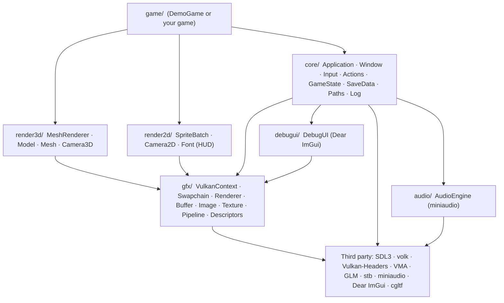

| Layer | Namespace | Responsibility | Shared with Game2D |
|---|---|---|---|
| `src/core` | `core` | Program lifetime, main loop, window, input, input actions, game states, settings and save files, file paths, logging | Yes, identical |
| `src/gfx` | `gfx` | Everything Vulkan: device, swapchain, frames, memory, textures, pipelines | Yes, identical |
| `src/audio` | `audio` | Sound effects, music, 3D sound (miniaudio) | Yes, identical |
| `src/debugui` | `debugui` | In-game debug overlay (Dear ImGui) | Yes, identical |
| `src/render2d` | `render2d` | 2D overlay: sprites, cameras, text (used for the HUD) | Yes, identical |
| `src/render3d` | `render3d` | 3D-specific rendering on top of `gfx` | No |
| `src/game` | (global) | The actual game; replaceable | No |

> `core` and `gfx` reference each other in one place only: `Application` owns the
> `VulkanContext` and `Renderer`, and `Window` creates the Vulkan surface. `gfx` itself
> depends only on `core::Window` (for the surface/size) and `core/Log.h`.

### Source map

```
src/
  main.cpp                    builds AppConfig, creates Application + Game, runs
  core/
    Application.h/.cpp        Game interface, AppConfig, main loop, fixed timestep
    Window.h/.cpp             SDL window, pixel size, fullscreen, Vulkan surface
    Input.h/.cpp              keyboard / mouse / gamepad state per frame
    Actions.h/.cpp            named input actions: bindings, rebinding, button prompts
    GameState.h/.cpp          game states (title, pause, game over) on a stack above the Game
    Paths.h/.cpp              basePath(), shaderPath(), assetPath(), saveFolder(), savePath()
    SaveData.h/.cpp           JSON save files (crash-safe writes, .bak fallback); settings.json
    Log.h                     LOG_* macros, core::fatal()
  audio/
    Audio.h/.cpp              AudioEngine: effects, music, 3D listener, mixer
    Effects.h/.cpp            effect nodes: filters, echo, reverb, smooth glides (internal)
    MiniaudioImpl.cpp         miniaudio + stb_vorbis implementation unit
  debugui/
    DebugUI.h/.cpp            Dear ImGui setup, input sharing, rendering, textures
  gfx/
    VkCommon.h                single Vulkan include (vulkan.h + volk + VMA), VK_CHECK
    Implementations.cpp       VMA, stb_image and stb_truetype implementation units
    VulkanContext.h/.cpp      instance, debug messenger, GPU selection, device, VMA
    Swapchain.h/.cpp          swapchain + image views + per-image semaphores
    Renderer.h/.cpp           frames in flight, acquire/submit/present, main pass
    Buffer.h/.cpp             VkBuffer + VMA allocation
    Image.h/.cpp              VkImage + view, imageBarrier() helper
    Texture.h/.cpp            Image + sampler + descriptor set, mip generation
    Pipeline.h/.cpp           Pipeline (RAII) + PipelineBuilder, SPIR-V loading
    Descriptors.h/.cpp        layout builder, growable allocator, writer
  render2d/                   shared with Game2D; used here for the HUD
    Camera2D.h/.cpp           orthographic camera (screen space for the HUD)
    SpriteBatch.h/.cpp        batched textured quads, drawText
    Font.h/.cpp               TrueType font baked into an atlas (stb_truetype)
    Animation.h/.cpp          SpriteSheet (grid or Aseprite JSON), clips, Animator
  render3d/
    Camera3D.h/.cpp           perspective camera (yaw/pitch, Vulkan clip conventions)
    Frustum.h/.cpp            the six planes of a view; is a (transformed) box or sphere in it?
    Mesh.h/.cpp               Vertex, MeshData, primitives::cube/plane/sphere, GPU Mesh
    Tangents.h/.cpp           generateTangents: MikkTSpace tangents for normal maps
    Model.h/.cpp              glTF 2.0 models (cgltf): ModelData, Model, ModelPose, ModelAnimation, skins
    ModelAnimator.h/.cpp      plays a model's animations into a ModelPose (blending, loops, moments)
    Raycast.h/.cpp            Ray; distance to a plane, sphere or (transformed) box
    ThirdPersonCamera.h/.cpp  follow/orbit camera with zoom, shoulder offset and collision
    MeshRenderer.h/.cpp       lit, textured forward renderer for meshes and models, with sun shadows,
                              GPU skinning, instancing and frustum culling; Material, SceneLighting,
                              ShadowSettings
  game/
    DemoGame.h/.cpp           example scene: fly and third-person cameras, a walking player
shaders/                      GLSL sources (compiled to SPIR-V at build time)
  common.glsl                 shared uniform / push-constant declarations (include)
  instance.glsl               instancing: the instance matrix buffer (include, every vertex shader)
  tangents.glsl               normal maps: the tangent frame (include, mesh.vert and mesh_skinned.vert)
  morph.glsl                  morph targets (shape keys): weights and offsets (include, every mesh vertex shader)
  mesh.vert, mesh.frag        the mesh shaders (mesh.frag also reads the shadow map)
  shadow.vert, shadow.frag    the shadow pass: depth from the sun (alpha-masked parts cut out)
  skin.glsl                   skinning: joints, weights and the joint matrix buffer (include)
  mesh_skinned.vert           mesh.vert for skinned meshes (bent by their joints first)
  shadow_skinned.vert         shadow.vert for skinned meshes
  sprite.vert, sprite.frag    the 2D overlay shaders (shared with Game2D)
  imgui.frag                  Dear ImGui's fragment shader, sRGB-correct (debug UI)
assets/                       runtime data (copied next to the executable)
  fonts/                      Roboto Medium + its licence
  sounds/                     demo sounds (CC0) + README
  models/                     drone, gunner (rigid parts), soldier (skinned), rifle, tree (CC0) + README
  textures/                   crate.png and its normal map, crate_normal.png
tools/                        Python scripts that generate the demo's models, sounds and normal map
cmake/                        Dependencies.cmake, Shaders.cmake
```

---

## 3. Module reference

### 3.1 core

**`core::Application`** owns every long-lived system and runs the main loop.
Construction order (and reverse destruction order) is significant:

1. `SDL_Init(VIDEO | GAMEPAD)`, then `settings.json` is loaded (if `rememberSettings`) and
   its fullscreen, vsync and volumes are written into the config, so everything below
   starts as the player left it
2. `Window` → 3. `Input` → 4. `gfx::VulkanContext` → 5. `gfx::Renderer` →
   6. `audio::AudioEngine` → 7. `debugui::DebugUI` (if enabled)

Its destructor tears down in exactly the reverse order, then calls `SDL_Quit()`.

**`core::Game`** is the interface a game implements. Every hook is optional:

| Hook | When | Typical use |
|---|---|---|
| `onInit` | once, after the GPU is ready | load textures, create meshes and `MeshRenderer`, set up state |
| `onFixedUpdate(dt)` | 0..n times per frame at a fixed rate (default 60 Hz) | gameplay simulation, physics |
| `onUpdate(dt)` | once per frame, real frame time | input handling, camera, animation |
| `onPreRender(frame)` | before the main render pass begins | uploads, off-screen passes, compute |
| `onRender(frame)` | inside the main pass (cleared, viewport set) | draw calls |
| `onResize(w, h)` | swapchain size changed | resize render targets / UI |
| `onDebugUI` | once per frame after `onUpdate`, only while the debug UI is visible | ImGui windows: stats, tweaks, buttons |
| `onShutdown` | after `vkDeviceWaitIdle`, before teardown | destroy GPU resources |

**`core::AppConfig`** groups configuration: window description, `gfx::RendererConfig`,
`audio::AudioDesc`, `debugui::DebugUIDesc`, fixed timestep, validation on/off,
FPS-in-title and fullscreen hotkeys.

**`core::Window`** wraps `SDL_Window` (created with `SDL_WINDOW_VULKAN |
SDL_WINDOW_HIGH_PIXEL_DENSITY`). It reports the *pixel* size (high-DPI aware), supplies
the Vulkan instance extensions SDL needs, and creates the `VkSurfaceKHR`.
Fullscreen is borderless "desktop" fullscreen (what gamescope on the Deck expects).

**`core::Input`** turns SDL events into per-frame state:

- `down` / `pressed` / `released` for keys (by scancode, layout-independent), mouse
  buttons and gamepad buttons. Presses are latched from events, so a tap shorter than a
  frame is never lost.
- Mouse position/delta in framebuffer pixels, wheel, relative mouse mode.
- First connected gamepad, with hot-plug fallback; radial dead zone on sticks; triggers
  0..1; rumble. Steam Deck controls arrive as a standard gamepad through Steam Input.
- Keys and buttons are released on focus loss to avoid "stuck" input.

**`core::Actions`** (`app.actions()`) sits on top of `Input`: the game names what the player
does ("jump", "left") and asks about that name, never about a key.

- `define(name, {bindings})` sets the default inputs. A `Binding` is a key, mouse button,
  gamepad button, or one direction of a stick or trigger (`Binding::axis(axis, ±1)`).
- Reading: `down`, `pressed` (taps shorter than a frame still count), `released`, `value`
  (0..1, analog for sticks and triggers) and `vector(left, right, up, down)` (a direction
  of length ≤ 1; analog with a stick). Unknown names log a warning once and read as idle.
- `consume(name, bufferSeconds = 0.15)` is a **buffered press** for `onFixedUpdate`: the
  press is kept until a step uses it (or it expires), so it's never lost between steps or
  used twice.
- Rebinding: `addBinding`, `removeBinding`, `setBindings`, `resetToDefaults`,
  `resetAllToDefaults`, `actionsUsing` (clashes) and `capture()` (the first input pressed
  this frame, for "press a key" screens). `saveBindings()`/`loadBindings()` convert to and
  from JSON text such as `{"jump": ["key:Space", "pad:a"]}`.
- Prompts: `lastDevice()` switches on whatever the player touched last (a key, click,
  button or stick), and `prompt(name)` names that device's first binding: "Space", "A",
  "Cross", "Left Stick Up". Gamepad names follow the pad's own labels (Xbox and Steam Deck
  A/B/X/Y, PlayStation Cross/Circle/Square/Triangle, Nintendo).
- `Application` updates it once per frame, after events and **before** `onFixedUpdate`, so
  both hooks see this frame's presses.

**Game states** (`core/GameState.h`, `app.states()`): screens such as a title, a pause menu
or a game-over screen, as classes derived from `core::GameState`, on a stack above the
`Game`. The `Game` is always the bottom layer.

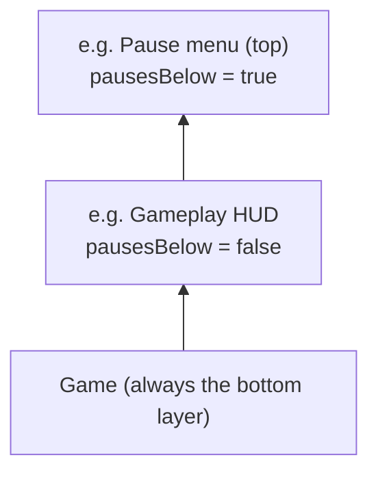

- A state has the `Game`'s hooks (`onFixedUpdate`, `onUpdate`, `onPreRender`, `onRender`,
  `onResize`, `onDebugUI`) plus `onEnter`/`onExit` (added to / removed from the stack) and
  `onPause`/`onResume`. The `Game` gets `onPause`/`onResume` too.
- Two settings per state: **`pausesBelow`** (default true: the layers below get no
  `onFixedUpdate`/`onUpdate`) and **`hidesBelow`** (default false: the layers below aren't
  drawn). Updating and drawing go bottom to top, starting at the lowest layer not paused
  (or hidden) by a state above it. `onDebugUI` goes to every state.
- `push`, `pop`, `replace` (pop, then push) and `clear` are **queued** and applied at the
  start of the next frame, after `actions.update()`. So a state can remove itself from its
  own hooks, and a frame never runs with a half-changed stack. `onEnter`/`onExit` may queue
  further changes (a splash screen replacing itself), applied in the same frame up to a
  limit. Then each layer whose paused state changed gets `onPause` or `onResume`.
- After any change, `Actions::clearPresses()` forgets that frame's presses and buffered
  `consume` presses, so the press that closed a menu can't also act in the game.
- `timeInState()` counts the seconds a state has been active (not while paused).
- At shutdown, after the GPU is idle, states get `onExit` top first and are destroyed,
  then `Game::onShutdown` runs.
- The Engine panel's **Game states** section lists the stack.

**`core::Paths`** resolves everything relative to the executable directory
(`SDL_GetBasePath()`): `shaderPath("x.vert.spv")` → `<exe>/shaders/…`,
`assetPath("textures/x.png")` → `<exe>/assets/…`. The working directory never matters.
`saveFolder()` is the player's writable folder, from `SDL_GetPrefPath(organization,
application)` (`AppConfig`): `%APPDATA%\<org>\<app>\` on Windows, `~/.local/share/<org>/<app>/`
on Linux and Steam Deck. `GAME_SAVE_DIR` overrides it. `savePath("x.json")` is a file in it.

**Settings and save files** (`core/SaveData.h`). A `SaveData` is a JSON object in a file
(in the save folder unless given an absolute path) with typed accessors:

- `getBool/getInt/getFloat/getString(key, fallback)` and `set(key, value)`; keys may use
  dots for nested objects (`"audio.music"`). Missing keys and wrong types give the
  fallback, so a first run, an older file or a hand-edited file never breaks the game.
  `has`, `remove`, `clear`, `erase` (delete the file and backup), `json()` for anything else.
- `save()` writes `<file>.tmp` (flushed), renames the current file to `<file>.bak`, then
  renames the temp file into place (`SDL_RenamePath` replaces atomically on Windows and
  POSIX). `load()` falls back to the `.bak` if the file is unreadable or not a JSON
  object, and a following `save()` then leaves the good backup alone. Floats are written
  in their shortest form (`0.7`, not `0.699999988`).
- The path is worked out on first use, so a `SaveData` member is safe to construct
  before the `Application` sets the folder names.

`app.settings()` is the framework's own `SaveData` (`settings.json`), used when
`AppConfig::rememberSettings` is true (the default):

- **Start-up:** `video.fullscreen`, `video.vsync` and `audio.master/sfx/music` override the
  config before the window, renderer and audio engine are created (volumes clamped to
  0..2); `audio.muted` is applied to the engine. After `Game::onInit` (once the actions
  exist), `controls` is passed to `Actions::loadBindings`.
- **Exit:** after `Game::onShutdown`, `saveSettings()` writes the *current* state (window,
  renderer, audio engine, actions) into the file and saves it. Only actions whose bindings
  differ from their defaults are written, so changed defaults reach players who didn't
  rebind. The game's own values (by convention under `"game"`) are kept.
- `saveSettings()` can be called any time (an options screen closing); `resetSettings()`
  restores the config's defaults and every action's default bindings.
- The Engine panel's **Settings & saves** section shows the folder and has *Open folder*,
  *Save settings now* and *Reset settings*.

**`core/Log.h`** maps `LOG_INFO/WARN/ERROR/DEBUG` onto SDL's logger and provides
`core::fatal(fmt, …)`, which logs, shows a message box and aborts (see §9).

### 3.2 gfx

**`gfx::VulkanContext`**: one per application.

- Loads Vulkan at runtime through **volk** (`volkInitialize`); nothing links against
  `vulkan-1.dll` / `libvulkan.so`.
- Creates the instance (API 1.3), optionally with `VK_LAYER_KHRONOS_validation` and a
  `VK_EXT_debug_utils` messenger.
- Picks a GPU: must support Vulkan 1.3, `VK_KHR_swapchain`, `dynamicRendering`,
  `synchronization2`, `shaderDemoteToHelperInvocation` (what `discard` compiles to under
  SPIR-V 1.6), and graphics + present queues. Scores discrete > integrated and
  prefers a single queue family for both.
- Creates the device (enables anisotropy and `fillModeNonSolid` when available) and the
  **VMA** allocator.
- Provides `immediateSubmit(lambda)` for blocking, load-time GPU work (uploads).
- Owns the shared **texture descriptor set layout** (binding 0 = combined image sampler,
  fragment stage) and a growable, free-able `DescriptorAllocator` for texture sets.

**`gfx::Swapchain`**: creation and recreation of the swapchain, its image views and
one *render-finished* semaphore **per swapchain image**.

- Format: `B8G8R8A8_SRGB` / `R8G8B8A8_SRGB` with sRGB non-linear colour space.
- Present mode: FIFO when vsync is on; otherwise MAILBOX → IMMEDIATE → FIFO.
- Image count: at least 3 (triple buffering), clamped to the surface limits.

**`gfx::Renderer`**: the frame loop on the GPU side (details in §5).
Configured by `RendererConfig { vsync, depthBuffer, clearColor, framesInFlight }`.
Game3D uses `depthBuffer = true`: the renderer then owns a depth image (see §5.3).

**`gfx::Buffer`**: `VkBuffer` + `VmaAllocation`. `MemoryUsage::GpuOnly`,
`CpuToGpu` (persistently mapped, sequential write) or `GpuToCpu` (mapped, cached).
`Buffer::createWithData()` uploads via a staging buffer. `write()` / `flush()` for
mapped buffers.

**`gfx::Image`**: `VkImage` + view + allocation for textures and render targets.
`imageBarrier()` records a single sync2 image barrier/layout transition.

**`gfx::Texture`**: a sampled RGBA8 image with its own sampler and **its own
descriptor set**, so a texture can be bound with a single call and needs no lookup tables.
Created from pixels (`fromPixels`), from a file via stb_image (`fromFile`) or as a solid
colour (`solid`). `TextureDesc` selects sRGB vs UNORM, mipmaps (generated on the GPU by
blitting), filtering and wrap mode (`wrap` for both directions, or `wrapV` for a different
vertical one). Linear filtering with mipmaps also enables
anisotropic filtering (up to 16×) when the GPU supports it, which keeps ground
textures sharp at grazing angles.

**`gfx::Pipeline` / `gfx::PipelineBuilder`**: fluent builder for graphics pipelines
using dynamic rendering (`VkPipelineRenderingCreateInfo` with attachment formats).
Viewport and scissor are always dynamic state; `dynamicCulling()` also makes cull mode and
front face dynamic (`vkCmdSetCullMode`/`vkCmdSetFrontFace`), so one pipeline can draw
single- and double-sided or mirrored geometry. Blend modes: `Opaque`, `Alpha`,
`PremultipliedAlpha`, `Additive`.

**`gfx::Descriptors`**: `DescriptorLayoutBuilder`, `DescriptorAllocator` (adds a new pool
whenever the current one is exhausted; optional per-set freeing) and `DescriptorWriter`
(batches `vkUpdateDescriptorSets`).

### 3.3 render3d

**`render3d::Camera3D`**: perspective camera.

- Right-handed world, **+Y up**, looks down **−Z** by default (`yaw = −π/2`).
- `position`, `yaw`, `pitch` (radians), `fovY` (default 60°), `nearPlane` (0.1),
  `farPlane` (500), aspect via `setAspect()`.
- `forward()` / `right()` / `up()` basis vectors, `lookAt(target)`.
- `projection()` follows Vulkan conventions: depth range [0, 1] (GLM is built with
  `GLM_FORCE_DEPTH_ZERO_TO_ONE`) and Y flipped (`proj[1][1] *= -1`) so +Y is up on screen.

**`render3d::Mesh` and `MeshData`**

- `Vertex { vec3 position; vec3 normal; vec2 uv; vec4 color; vec4 tangent; }` (64 bytes;
  `color` is a linear vertex colour, white by default, used by glTF models that have one;
  `tangent` is the direction u runs across the surface plus a handedness sign in `w`, for
  normal maps, all zero when there are none).
- `generateTangents(MeshData&)` (`Tangents.h`) fills in the tangents with MikkTSpace
  (§6.9); a second overload works on a range of shared arrays and copies vertices where
  two triangles need different tangents. The primitives call it, so they're ready for a
  normal map.
- `MeshData` = vertices + `uint32` indices, triangles **counter-clockwise** seen from the
  front.
- `primitives::cube(size)` (24 vertices, per-face normals/UVs), `plane(size, uvRepeat)`
  (XZ plane facing +Y), `sphere(radius, segments, rings)`, all with tangents.
- `Mesh` uploads `MeshData` into **device-local** vertex and index buffers once (via
  staging) and draws itself with `draw(cmd)`: bind buffers + one `vkCmdDrawIndexed`.
  `bind(cmd)` + `drawRange(cmd, firstIndex, indexCount, vertexOffset)` draw part of it
  (a model's parts share one `Mesh`). `boundsMin()` / `boundsMax()`: the box around its
  vertices, for frustum culling.

**`render3d::Model`, `ModelData`, `ModelPose`**: glTF 2.0 models (`.gltf` + `.bin` +
images, or one `.glb`), parsed with cgltf.

- `loadModelData(path, data, &error)` reads a file into `ModelData` on the CPU (no GPU:
  usable in tools and tests); `Model::load(gpu, path)` loads and uploads, and stops with
  a clear message if the file can't be used (like textures and sounds).
- **Geometry:** every primitive's vertices and indices go into **one** `Mesh`; a
  `ModelPrimitive` is a range in it (`firstIndex`, `indexCount`, `vertexOffset`) with a
  material. Triangle strips and fans become lists; points and lines are skipped with a
  warning. Missing normals give flat shading; missing UVs give (0, 0).
- **Nodes** are stored parents-before-children, each with a translation, rotation
  (quaternion) and scale relative to its parent (a node's matrix is decomposed). Only the
  default scene is used. `findNode(name)` returns the index, or -1 with a warning once.
- **`ModelPose`**: per-copy node transforms (`defaultPose()`, then
  `pose[node].rotation = ...`), so many copies of one `Model` can each have their own
  pose. Index -1 is accepted and ignored. `nodeMatrices(transform, pose, out)` gives every
  node's world matrix; `nodeMatrix(node, transform, pose)` gives one (walking up its
  parents), which is how a model is attached at another's **socket** (an empty node).
- **Animations** (`ModelAnimation`: one per Blender Action): channels of keyframes, each
  for the translation, rotation or scale of one node, with glTF's linear (rotations:
  shortest-path slerp), step or cubic-spline interpolation. `apply(time, pose)` writes the
  animated nodes' values at a time into a pose and leaves the others alone. The
  duration is the last keyframe's time. `findAnimation(name)` returns -1 and warns once,
  listing the model's animations. Shape key (morph weight) channels are skipped with a
  warning (the game sets weights when drawing; see Morph targets below).
- **Skins** (`ModelSkin`: Blender's armature): a list of joint nodes and an inverse bind
  matrix for each (identity if the file has none). A node with a mesh and a skin has
  `skin >= 0`; its primitives carry `JOINTS_0` (any integer type) and `WEIGHTS_0` (float or
  normalised), stored as one `SkinVertex { u16vec4 joints; vec4 weights; }` (24 bytes) per
  vertex in `ModelData::skinVertices`, parallel to `vertices` (zeros for unskinned ones),
  and uploaded as a second vertex buffer (`skinVertices()`). Weights are normalised to
  add up to 1. A skin whose joints are outside the scene, or a mesh whose joint indices
  don't fit its skin, is drawn unbent with a warning; a second set of influences
  (`JOINTS_1`) is ignored with a warning (4 per vertex). As glTF specifies, the skinned
  node's own transform is ignored. `jointMatrices(skin, nodeMatrices, out)` gives
  `nodeMatrix[joint] · inverseBind[joint]` for each joint: the matrix that takes a
  bind-pose vertex to where that joint has moved it. `skinBounds(skin, joints, min, max)`
  gives the box around the mesh as those matrices bend it, for culling: at load, each joint
  gets the box around the bind-pose vertices it moves at all; each frame those boxes are
  moved by their joint matrices and joined. A bent vertex is a weighted average of where
  its joints would put it, so it always lies inside (no skinning on the CPU).
- **Materials** (`ModelMaterial`): base colour factor and texture, emissive factor (times
  `KHR_materials_emissive_strength`) and texture, **normal texture and its scale**,
  metallic and roughness factors, alpha mode (opaque, mask with cutoff, blend),
  double-sided, `KHR_materials_unlit`. The
  spec-gloss extension falls back to its diffuse colour and texture.
- **Textures**: PNG and JPEG (stb_image) from a buffer view, a data URI or a file beside
  the `.gltf`; per-texture filter and per-axis wrap (`TextureDesc::wrap`/`wrapV`), mipmaps,
  sRGB (linear for textures used as normal maps).
- **Tangents** for parts with a normal map: the file's `TANGENT` attribute if it has one,
  otherwise `generateTangents` at load (MikkTSpace, as glTF specifies and Blender exports;
  checked against Blender's own tangents in Khronos' NormalTangentMirrorTest: identical).
  Vertices that need two tangents are copied, with their joints and weights. Parts
  without a normal map get no tangents (and no extra vertices).
- **Morph targets** (Blender's shape keys; §6.10): each primitive's `POSITION` and `NORMAL`
  target offsets (sparse accessors too) go into `ModelData::morphDeltas` (`MorphDelta {
  vec3 position; vec3 normal; }`, 24 bytes), each vertex's targets side by side; a
  primitive records where its run starts (`morphFirst`) and how many targets it has
  (`morphTargets`). Vertices the loader makes (flat-shading corners, copies for split
  tangents) get the offsets of the file vertex they came from. A mesh keeps its targets'
  names (`targetNames`, from Blender's `extras.targetNames`; "target N" otherwise), its
  default weights (`mesh.weights`) and, per target, the box its offsets span (for bounds
  and culling). **Weights** are numbered model-wide: each node with a morphed mesh owns
  a run of `ModelData::morphWeights` from `ModelNode::firstMorphWeight`, at the node's own
  `weights` if it has them, else the mesh's (glTF's rule). `Model::defaultMorphWeights()`,
  `morphWeightCount()`, `findMorphTarget(name)` / `findMorphTarget(node, name)` (-1 and one
  warning listing the names), `morphTargetName(i)`. Tangent offsets are ignored (one
  warning); the default bounds use the default weights.
- **Not supported** (warned about, the rest still loads): metallic-roughness and
  occlusion textures, morph target animations and tangent offsets, cameras, lights,
  KTX2/WebP images. Files that *require* Draco or meshopt compression are refused with a message
  saying how to export without it.
- Bounds (`boundsMin/Max`, `size`, `center`) are of the default pose, in model units;
  skinned meshes are bent into the default pose on the CPU (at load) to measure them.
- Tested with the Khronos samples RiggedSimple, RiggedFigure, CesiumMan and Fox, and the
  generated `soldier.glb`.

**`render3d::ModelAnimator`**: plays one animation of a model at a time and keeps the pose
to draw with; one per animated object, like the 2D `Animator`.

- `play(model, name, loop, restart)`: `AnimationLoop::Loop`, `Once` (holds the last pose,
  then `finished()`), `PingPong`. Asking for the animation already playing does nothing
  unless `restart`; an unknown name keeps the current one. `stop()` blends back to the
  default pose.
- `update(dt)` advances time (× `speed`), then rebuilds the pose: the model's default
  pose with the animation applied. While a blend is running (`blendTime`, 0.15 s by
  default) it mixes the pose captured at the moment of the change into the new one
  (translation and scale lerp, rotation slerp, eased with smoothstep), so nodes the new
  animation doesn't touch also ease back.
- **Moments:** `update` records which stretch of time it passed (two stretches when a
  loop wraps), and `reached(t)` checks a time against them, so each moment fires exactly
  once per pass however long the frame; `reached(0)` is true on the first update after
  `play`.
- `pose()` is writable after `update()`, for procedural adjustments (aiming) on top of an
  animation; they don't accumulate because the next update rebuilds the pose.
- It points at its `Model`, which must stay alive and in place.

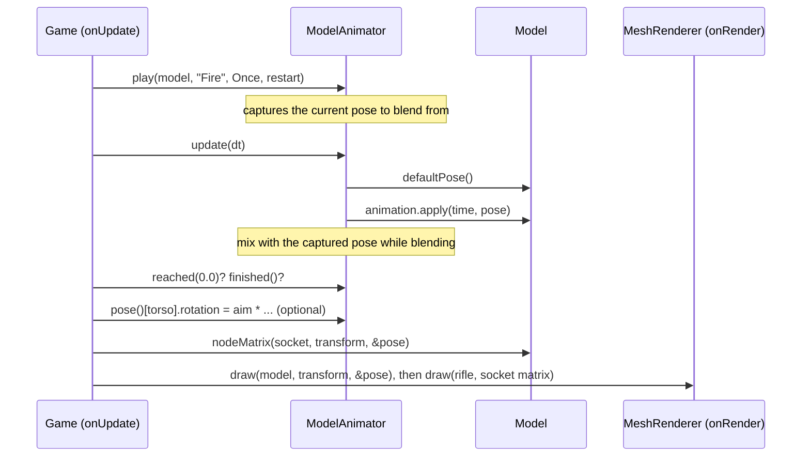

**`render3d/Raycast.h`**: ray tests against simple shapes, for camera collision, shooting,
line of sight and mouse picking.

- `Ray { origin, direction }` (direction normalised, so results are world distances);
  `at(d)` is the point at distance `d`.
- `raycastPlane(ray, point, normal)` (either side), `raycastSphere(ray, centre, radius)`,
  `raycastBox(ray, transform, halfExtents = 0.5)`: each returns `std::optional<float>`,
  the distance to the first hit. `raycastBox` takes a model matrix (position, rotation,
  scale) and moves the ray into the box's space (slab test); the default half-extents fit
  `primitives::cube(1.0f)`, so the matrix a crate is drawn with also tests against it.
- A ray that starts inside a sphere or box doesn't hit it, so a camera whose target stands
  inside a shape (a trigger volume, say) isn't blocked by it.
- No triangle-mesh tests yet: games describe their colliders with these shapes.

**`render3d::Frustum`**: what a view-projection matrix can see, as six planes (left, right,
bottom, top, near, far) with unit normals pointing in, read straight out of the matrix
(Gribb & Hartmann, for Vulkan's `0 <= z <= w`). Works for perspective and orthographic
matrices alike (the sun's shadow map is one).

- `Frustum(camera.viewProjection())`; a default-constructed one contains everything.
- `intersects(min, max, transform = identity)`: could any of the box `min..max`, placed by
  a model matrix, be inside? The box is tested as placed (turned and scaled, not the
  upright box around it), one plane at a time: a box just outside a corner can still
  answer true, a box partly inside never answers false. `intersectsSphere(centre,
  radius)`. `planes()` for anything else.
- `MeshRenderer` culls with it (§6.8); games can use it to skip other work for things off
  screen (animation, effects).

**`render3d::ThirdPersonCamera`**: follows a target from behind and orbits around it.

- Public settings: `yaw`/`pitch` (Camera3D's convention: the view direction), `distance`
  (`minDistance`..`maxDistance`), `targetOffset` (feet to the look-at point, 1.55 m up),
  `shoulder` (sideways shift, 0.45 m), `minPitch`/`maxPitch`, `followSharpness` (12),
  `zoomSharpness` (10), `returnSharpness` (4), `collisionRadius` (0.25 m).
- `orbit(dYaw, dPitch)` (pitch clamped, yaw kept in −π..π), `zoom(steps)` (15 % per step;
  the mouse wheel), `update(target, dt, raycastFn)`, `snapTo(target)` (no easing; the
  first `update` does it too), `apply(camera)` (position, yaw, pitch; fov and planes kept).
- `flatForward()` / `flatRight()`: the view directions along the ground, for moving a
  player relative to the camera. `position()`, `lookAtPoint()`, `currentDistance()`,
  `blocked()`.
- `update`: the pivot follows the target and the zoom follows `distance`, each by
  `1 − exp(−sharpness·dt)` (frame-rate independent; sharpness 0 = rigid). The look-at
  point is pulled in from the shoulder if a ray sideways hits something. Then five rays
  are cast backwards (from the look-at point and from four points `collisionRadius` around
  it, a cheap stand-in for a sphere cast); the room behind is the nearest hit minus
  `collisionRadius`. Less room than the current distance: jump there now (the view is never
  blocked). More: ease out with `returnSharpness` (no popping back and forth past posts).
- The ray function is the game's (`std::function<std::optional<float>(const Ray&)>`),
  typically the nearest of `raycast*` calls over the level's colliders; without one there
  is no collision.

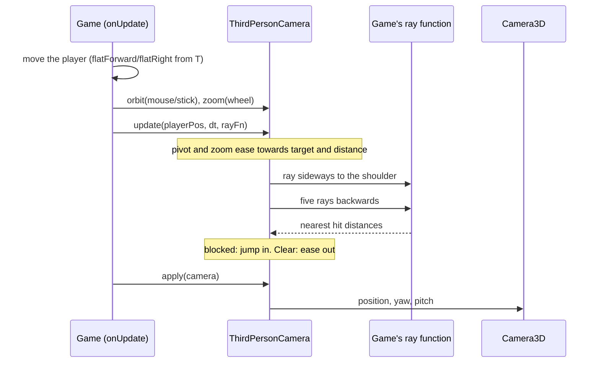

**`render3d::MeshRenderer`**: forward renderer for lit, textured meshes and models, with
shadows from the sun, GPU skinning and instancing (details in §6). API:
`MeshRenderer(gpu, renderer, shadowMapSize = 2048, maxJoints = 8192, maxInstances = 16384)`,
`begin(frame, camera, lighting)`, `draw(mesh, modelMatrix, material)`,
`draw(model, transform, pose = nullptr)`, `draw(model, transform, pose, materialColors)`
(one linear RGBA per material, replacing its base colour: one model in many colour schemes;
a shorter or empty span keeps the file's colours), `end()`, `setWireframe(bool)`, `drawCalls()`;
for shadows `beginShadows(frame, camera, lighting)` / `endShadows()` around the same
`draw()` calls in `onPreRender`, `shadowDrawCalls()`, `shadowMapSize()`,
`shadowTexelSize()`; for skinning `jointsUsed()` / `maxJoints()`. Skinned models need no
different calls: `draw(model, ...)` bends them (§6.6). Many copies at once:
`drawInstanced(mesh, models, material)` and `drawInstanced(model, transforms, pose)` take a
`std::span<const glm::mat4>` (a vector or array) and draw every copy in one draw call per
part (§6.7); `instancesUsed()` / `maxInstances()`. Frustum culling is on by default (§6.8):
`setFrustumCulling(bool)`, `setCullingFrozen(bool)` (keep the frustums of that moment, to
look at them from outside), `culled()` / `shadowCulled()` (parts and copies left out),
`triangles()` / `shadowTriangles()`. Normal maps (§6.9): `Material::normalTexture` /
`normalScale`, or a model's own; `setNormalMaps(bool)` switches them all off to compare.
Morph targets (§6.10): `draw(model, transform, pose, materialColors, morphWeights)` and
`drawInstanced(model, transforms, pose, morphWeights)`, one weight per entry of
`model.defaultMorphWeights()` (an empty or shorter span keeps the file's weights for the
rest); `morphWeightsUsed()` / `maxMorphWeights()` (the constructor's sixth argument, 65536).
It needs a depth buffer, and says so at start-up if there isn't one.

- `Material { texture, color, emissive, emissiveStrength, emissiveTexture, normalTexture,
  normalScale, roughness, metallic, doubleSided, castShadows }`: textures may be `nullptr`
  (an internal 1×1 white texture, or a flat normal, is used); colours are sRGB; the normal
  texture is loaded with `TextureDesc::srgb = false`. A model brings its own `ModelMaterial`s (linear
  colours, as in glTF); models always cast shadows, except their Blend parts.
- `SceneLighting`: sun direction/colour/intensity, sky and ground ambient colours with an
  ambient intensity, fog colour and density, and `shadows`. All colours are sRGB.
- `ShadowSettings { enabled, distance (30 m), strength (1), softness (1 texel),
  normalBias (1 texel), depthBias (1.5 texels) }`: biases and softness are in shadow-map
  texels, so they hold when the distance or map size changes (§6.5).

### 3.4 render2d (HUD)

Game3D includes Game2D's `render2d` module unchanged. A `SpriteBatch` can draw inside the
3D main pass: its pipeline is created with the renderer's depth format but doesn't test or
write depth, so a HUD drawn after the meshes always appears on top. The demo uses a
`Camera2D` positioned at the screen centre (one unit = one pixel) for its HUD.

**`render2d::SpriteBatch`**: batched textured quads; `draw`, `drawRect`, `drawLine`,
`drawText`. **`render2d::Camera2D`**: orthographic camera (+Y down).

**`render2d::Font`**: a TrueType/OpenType font baked into a texture atlas (details in
§6.4). `Font::load(gpu, path, FontDesc)` rasterises a contiguous range of characters
(default: printable ASCII + Latin-1) at `FontDesc::pixelHeight` (default 48 px).
`measure(text, size)`, `lineHeight(size)` and `ascent(size)` support layout. Text is drawn
with `SpriteBatch::drawText(font, utf8, position, TextStyle)`; `TextStyle` sets size,
colour, alignment (`Left`/`Center`/`Right`), line spacing and pixel snapping.

**`render2d::SpriteSheet` / `Animator`** (`render2d/Animation.h`): sprite-sheet
animation. A `SpriteSheet` owns a texture, its frames (UV rectangle, pixel size, default
duration) and named `AnimationClip`s (frame indices, per-frame durations, `Loop` / `Once` /
`PingPong`, and named events on frames). Sheets come from a grid (`loadGrid`, clips added
in code) or from **Aseprite's JSON export** (`loadAseprite`: tags become clips with their
frame durations and directions; parsed with nlohmann/json, keeping file order for "Hash"
exports). They load with nearest filtering and no mipmaps, so neighbouring frames never
blend. An `Animator` plays one clip for one object: `play` (a no-op if that clip is
already playing, so the game can state the wanted clip every step), `update(dt)` (handles
several frames per step, fires the events of every frame entered, and has a tiny tolerance
so 60 Hz steps change frames exactly on time), `uv(flipX)`, `finished()`,
`eventFired(name)`, and a `speed` multiplier. It points at its sheet, which must stay alive
and in place.
In Game3D it can animate HUD icons or 2D overlays; see the Game2D tutorial, step 12.

### 3.5 audio

**`audio::AudioEngine`** plays sound effects, music and 3D positional sound with
[miniaudio](https://miniaud.io). `Application` creates it after the renderer (from
`AppConfig::audio`, an `audio::AudioDesc`) and games reach it with `app.audio()`. The
module depends only on miniaudio, GLM and `core/Log.h`; it never touches Vulkan.

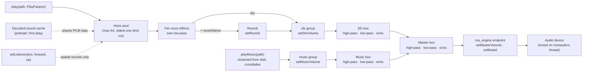

- **Sound effects** are decoded into memory the first time a file is played (or by
  `preload`) and cached, so later plays start instantly and share the same data. Each
  `play` returns a `SoundHandle` (a unique id that is never reused); stale handles are
  ignored, so a game can keep handles without tracking when sounds end.
- **`PlayParams`**: `volume`, `pitch`, `pan`, `loop`, for 3D sounds `spatial`,
  `position`, `minDistance`, `maxDistance`, `rolloff` (inverse-distance attenuation), and
  the sound's own effects: `lowPassHz` and `reverbSend`, and its `doppler` amount.
- **3D sound** is relative to a single listener set with `setListener(position, forward,
  up)`, in the same right-handed, +Y-up axes as `Camera3D`. Use mono files for spatial
  sounds.
- **Doppler.** Spatial sounds rise in pitch as they approach the listener and fall as
  they move away (miniaudio's spatializer, using the OpenAL formula). In `update(dt)`,
  each spatial sound's and the listener's velocity is estimated from how far it moved
  since the last frame (smoothed over ~0.1 s; a jump faster than sound counts as a
  teleport, not motion), unless the game sets it with `setVelocity` /
  `setListenerVelocity`. Velocities are capped at 0.3 × speed of sound ÷ factor, because
  the formula divides by (speed of sound − factor × speed). Settings: `speedOfSound` (in
  world units/s; 343 = metres) and `dopplerFactor` globally, `PlayParams::doppler` per
  sound. `dopplerPitch(handle)` reports the current shift. Non-spatial sounds and music
  never shift. 2D games get Doppler by playing sounds as spatial in the X/Y plane.
- **Music** is one streamed track at a time (`playMusic`, `stopMusic`, `pauseMusic`,
  `resumeMusic`). Starting a new track fades the old one out over
  `MusicParams::fadeOutPreviousSeconds`. Music is never spatialised.
- **Mixer**: master, sfx and music volumes, plus `setMuted`, which silences everything
  without changing the volumes.
- **Effects** (`audio/Effects.h/.cpp`, internal). Each bus (`Bus::Sfx`, `Bus::Music`,
  `Bus::Master`) has a custom miniaudio node with a high-pass (12 dB/octave), a
  low-pass (24 dB/octave) and an echo (a stereo delay line with feedback, up to 2 s). Every
  playing sound effect has its own node with a low-pass and a send to the shared
  **reverb** (verblib, a Freeverb implementation bundled with miniaudio). The reverb's
  output joins the sound-effects group, so the effects volume and the Sfx bus filters
  apply to the tail too; music never reaches it.
- **Glides.** Setters store a target that the audio thread approaches exponentially
  (`SmoothParam`, updated every 64 frames; filters glide in log-frequency so a sweep sounds
  even). Nothing clicks, and the game thread never waits on the audio thread. A filter at
  its "off" value is skipped entirely, and the reverb does no work while its level is 0.
  The bus and reverb nodes keep processing after their inputs stop, so echo and reverb
  tails finish naturally.
- **`update(dt)`** is called by `Application` once per frame, after `onUpdate`, with the
  frame time. It releases voices that have finished playing and updates the Doppler
  velocities; nothing else in the game loop depends on audio.
- **No device, no problem.** If no output device can be opened (or `GAME_AUDIO=0` is
  set, or `AudioDesc::enabled` is false), a warning is logged and every call becomes a
  no-op. `AudioDesc::noDevice` runs the mixer without a device so tests can pull samples
  with `readFrames()`.
- Formats: WAV, FLAC and MP3 (built into miniaudio) and OGG Vorbis (stb_vorbis, shipped
  with miniaudio). The implementation is compiled once in `audio/MiniaudioImpl.cpp`.
- **Threading.** Call the API from the game thread. Mixing runs on miniaudio's device
  thread; miniaudio handles the synchronisation.

---

### 3.6 debugui

**`debugui::DebugUI`** is an in-game debug overlay built on
[Dear ImGui](https://github.com/ocornut/imgui) with its SDL3 and Vulkan backends.
`Application` creates it after the audio engine when `AppConfig::debugUI.enabled` is
set, which is the default in Debug builds only. Release builds don't create it at all,
so `app.debugUI()` returns `nullptr` there.

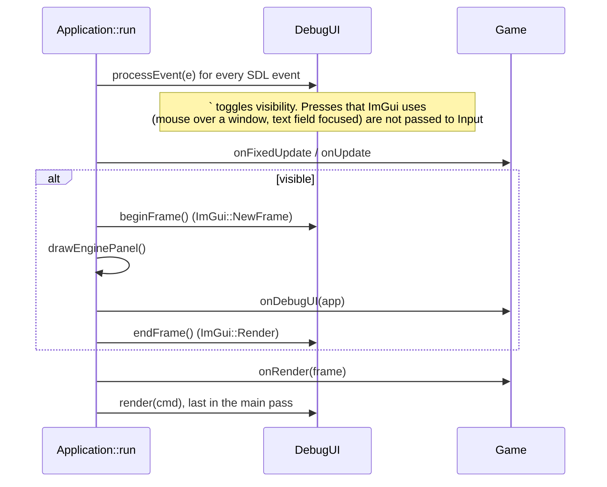

- **Games add windows in `Game::onDebugUI`**, called once per frame after `onUpdate`, only
  while the UI is visible. Including `core/Application.h` brings in `imgui.h`.
- **Input sharing.** Every event goes to ImGui first. A mouse-button press or wheel event
  over a debug window, or a key press while a text field has focus, is not passed to
  `core::Input`. Releases always are, so nothing gets stuck down. The toggle key
  (`DebugUIDesc::toggleKey`, default the key below Esc) is consumed by the debug UI.
- **Rendering.** ImGui's Vulkan backend draws with its own pipeline inside our main
  pass (dynamic rendering, created with the swapchain colour format and the renderer's
  depth format). It calls Vulkan through volk (`IMGUI_IMPL_VULKAN_USE_VOLK`). Its vertex
  buffers are per frame in flight. When the font atlas changes, the backend uploads it with
  its own command buffer and waits for the queue: a small, rare stall.
- **Colour.** ImGui's colours are sRGB values. Our swapchain is sRGB, so it expects linear
  values. `shaders/imgui.frag` replaces ImGui's fragment shader with one that converts
  vertex colours to linear, so ImGui looks exactly as designed.
- **Size.** The style and the font scale with the display's scale setting (e.g. 150% on
  Windows) times `DebugUIDesc::scale`. The font is the project's Roboto Medium if present;
  ImGui renders font glyphs on demand, so text stays sharp at any size.
- **Textures.** `DebugUI::texture(gfx::Texture)` registers a texture with the ImGui
  backend once (a descriptor set from its own pool, room for 64) and returns an
  `ImTextureID` for `ImGui::Image`.
- **The Engine panel** (`Application::drawEnginePanel`) shows a frame-time graph, GPU and
  swapchain details, vsync/fullscreen toggles, audio status and volumes, input devices, and
  a switch for ImGui's demo window. Turn it off with `DebugUIDesc::showEnginePanel`.
- `imgui.ini` is not written (`io.IniFilename = nullptr`), so window positions reset each
  run and nothing is written next to the executable.

---

## 4. Object ownership and lifetime

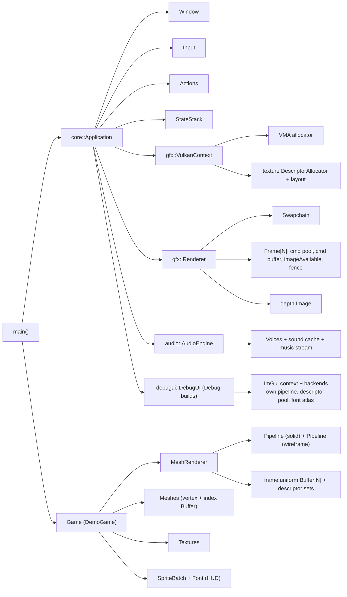

Rules:

- **All GPU wrappers are RAII and move-only** (`Buffer`, `Image`, `Texture`, `Pipeline`).
  They hold a pointer to the `VulkanContext` and destroy themselves in their destructor.
- In `main()`, the `Application` is declared before the `Game`, so the game (and every
  GPU object it owns) is destroyed first, while the device still exists.
- `Application::run()` calls `vkDeviceWaitIdle` before `onShutdown`, so destroying
  resources there or in the game's destructor is safe.
- **During gameplay**, destroying a resource that an in-flight frame may still use is an
  error. Call `renderer.waitIdle()` first, or keep resources alive for
  `framesInFlight` frames. (A deferred-deletion queue is a natural future addition.)
- In debug builds, VMA asserts at shutdown if any `Buffer`/`Image` leaked.

---

## 5. Main loop and frame lifecycle

### 5.1 CPU timeline

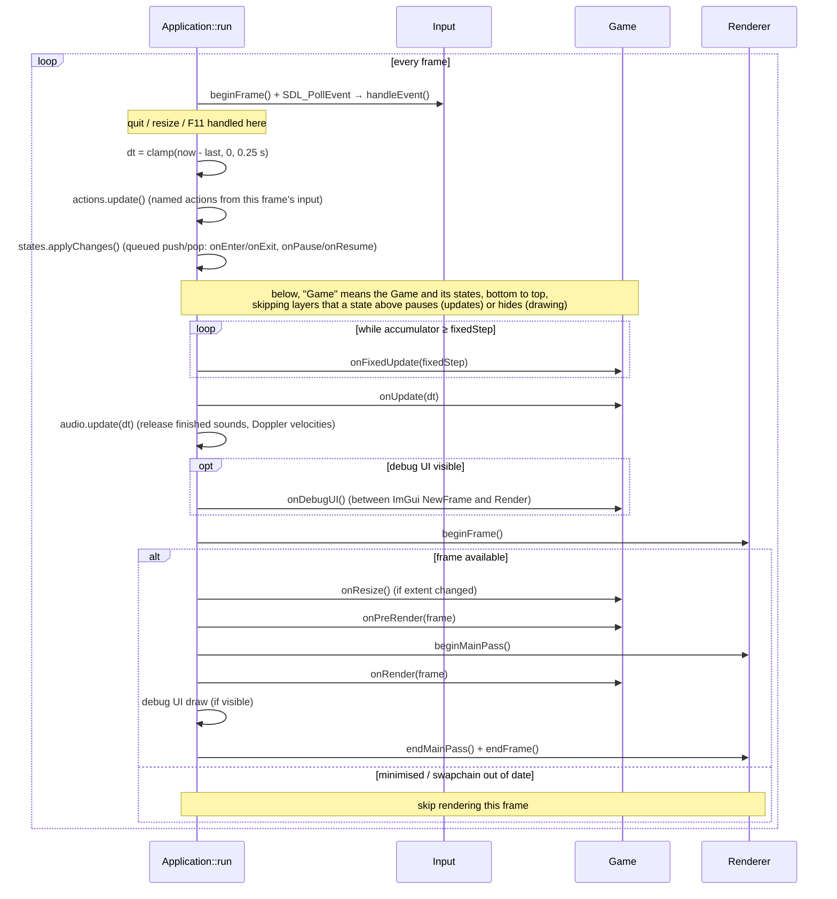

- **Fixed timestep with interpolation.** Simulation runs at `AppConfig::fixedTimestep`
  (1/60 s). `interpolationAlpha()` (0..1) tells how far the real time is between the last
  two fixed steps; render `mix(previousState, currentState, alpha)` for smooth motion on
  any refresh rate (144 Hz, 40 Hz Deck mode…). `DemoGame` does this for its animation
  (spin and bobbing); the fly camera is moved in `onUpdate` for the lowest input latency.
- `dt` is clamped to 0.25 s so a breakpoint or hitch doesn't cause a spiral of catch-up.
- When minimised the loop sleeps and resets the clock instead of rendering.

### 5.2 GPU frame (Renderer)

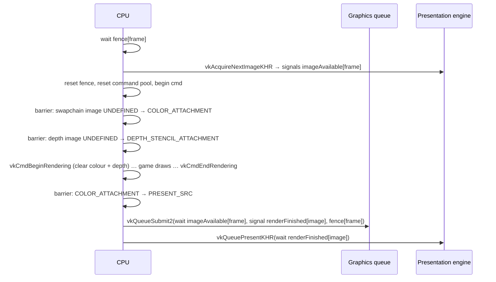

**Synchronisation objects**

| Object | Count | Purpose |
|---|---|---|
| Fence `inFlight` | per frame in flight (2) | CPU waits before reusing that frame's command buffer and per-frame buffers |
| Semaphore `imageAvailable` | per frame in flight | acquire → rendering may start writing the image |
| Semaphore `renderFinished` | **per swapchain image** | rendering done → presentation may read the image |
| Command pool + buffer | per frame in flight | reset as a whole each frame (cheap) |

`renderFinished` is per *image*, not per frame, because the presentation engine may still
hold a semaphore after the frame's fence signals; tying it to the image guarantees it is
not reused too early.

**Swapchain recreation** is triggered by a pixel-size change event, `VK_SUBOPTIMAL_KHR`
/ `VK_ERROR_OUT_OF_DATE_KHR` from acquire or present, or a vsync toggle. It waits for the
device to go idle, then recreates the swapchain (passing the old one as `oldSwapchain`) and
the depth buffer, if any. Simple and robust; resizing is rare enough that the idle wait does
not matter.

`FrameContext` is what the game receives: `cmd`, `frameIndex` (index your per-frame
resources with it), `imageIndex`, `frameNumber` and `extent`.

### 5.3 Depth buffer

- Format: the first of `D32_SFLOAT`, `D16_UNORM` that supports depth attachments
  (`D32_SFLOAT` on every desktop GPU and the Deck).
- **One** depth image is shared by all frames in flight. That is safe because every frame
  starts with a barrier from `LATE_FRAGMENT_TESTS / DEPTH_WRITE` (the previous frame's
  writes) to `EARLY|LATE_FRAGMENT_TESTS / DEPTH_READ|WRITE`, and both frames run on the same
  queue.
- Layout `DEPTH_STENCIL_ATTACHMENT_OPTIMAL`, cleared to **1.0** each frame, store op
  `DONT_CARE` (depth is not needed after the frame). Pipelines use compare `LESS`.
- Recreated together with the swapchain on resize.

> If you add a post-process that needs depth (SSAO, fog from depth, soft particles), change
> the store op to `STORE` and add `SAMPLED` to the image usage.

---

## 6. Mesh rendering

### 6.1 Data bound per draw

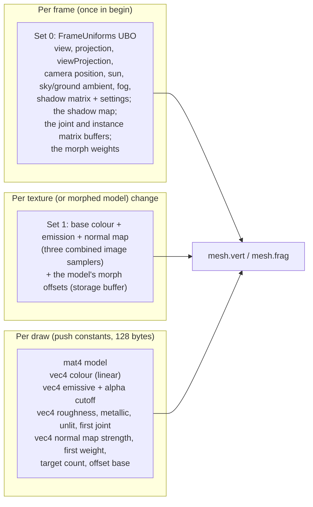

| Binding | Contents | Update frequency |
|---|---|---|
| Set 0, binding 0 (UBO, vertex + fragment) | `FrameUniforms`: matrices, camera position, lights, fog, shadow matrix and settings (std140) | once per frame, written into that frame's own buffer |
| Set 0, binding 1 (comparison sampler, fragment) | the shadow map | never (one image, rewritten by each shadow pass) |
| Set 0, binding 2 (storage buffer, vertex) | joint matrices of the skinned models drawn this frame (`maxJoints` × 64 bytes) | appended to by each skinned draw, in that frame's own buffer |
| Set 0, binding 3 (storage buffer, vertex) | instance matrices (`maxInstances` × 64 bytes); entry 0 is the identity, for single draws | appended to by each `drawInstanced`, in that frame's own buffer |
| Set 0, binding 4 (storage buffer, vertex) | morph target weights of the morphed nodes drawn this frame (`maxMorphWeights` floats) | appended to by each morphed draw, in that frame's own buffer |
| Set 1, bindings 0, 1 and 2 (samplers, fragment) | base colour, emission and normal textures | when any of them changes between draws |
| Set 1, binding 3 (storage buffer, vertex) | the model's morph offsets (`Model::morphDeltas()`), or a tiny empty buffer for everything else | when a morphed model's part is drawn after something else |
| Push constants (vertex + fragment) | model matrix (instanced: the part's matrix within the model), colour, emissive + alpha cutoff, roughness/metallic/unlit, first joint matrix (skinned), normal map strength (0 = none), morph targets: first weight, target count (0 = none), offset base (integers, bit for bit) | every draw |
| Vertex binding 1 (skinned only) | the model's `SkinVertex`es: joints and weights | when the skinned model drawn changes |
| Dynamic state | cull mode, front face | when a draw needs different culling (double-sided material, mirrored node) |

- The push-constant block is **128 bytes**, exactly the size every Vulkan GPU must
  support, so it works everywhere without querying limits. A `static_assert` protects it.
  It's full, to the last float (morph targets took `surface.yzw`): the next per-draw value
  has to move to a buffer (like the joints and weights, found by an index already pushed).
- The **normal matrix** (`transpose(inverse(mat3(model)))`) is computed in the vertex
  shader, so normals stay correct under non-uniform scaling and the push constants have
  room for material values.
- **Set 1** holds three textures (base colour, emission, normal) and the drawn model's
  morph offsets, so it can't be the
  texture's own set: sets are allocated from a **per-frame pool** that is reset when that
  frame comes round again, with a small cache so each combination gets one set per frame. No set
  outlives its textures.
- **Per-frame uniform buffers**: one host-visible UBO and descriptor set per frame in
  flight, so writing this frame's camera never races with the GPU reading last frame's.
- Redundant texture binds are skipped (`boundTexture_`), as are geometry binds when
  consecutive draws are parts of the same model. Sorting draws by texture reduces binds
  further.
- **Models:** `draw(model, transform, pose)` computes every node's world matrix and draws
  each primitive of each node's mesh with its material. **Blend** primitives are put
  aside and drawn in `end()`, sorted farthest first, with the blend pipeline (alpha
  blending, depth test without depth writes). A node whose matrix has a negative
  determinant (mirrored with a negative scale) is drawn with the front face set to
  clockwise, so its triangles aren't culled inside out. A skinned node is drawn with the
  skinned pipelines and the model's `transform` as its model matrix (§6.6).
- **Instances:** `drawInstanced` uploads one matrix per copy and draws each part once with
  that many instances; the vertex shaders multiply each copy's matrix by the push-constant
  matrix (§6.7).
- **Culling:** every draw, model part and copy is first tested against the pass's frustum:
  the camera's in the main pass, the shadow map's box in the shadow pass (§6.8).

### 6.2 Draw flow

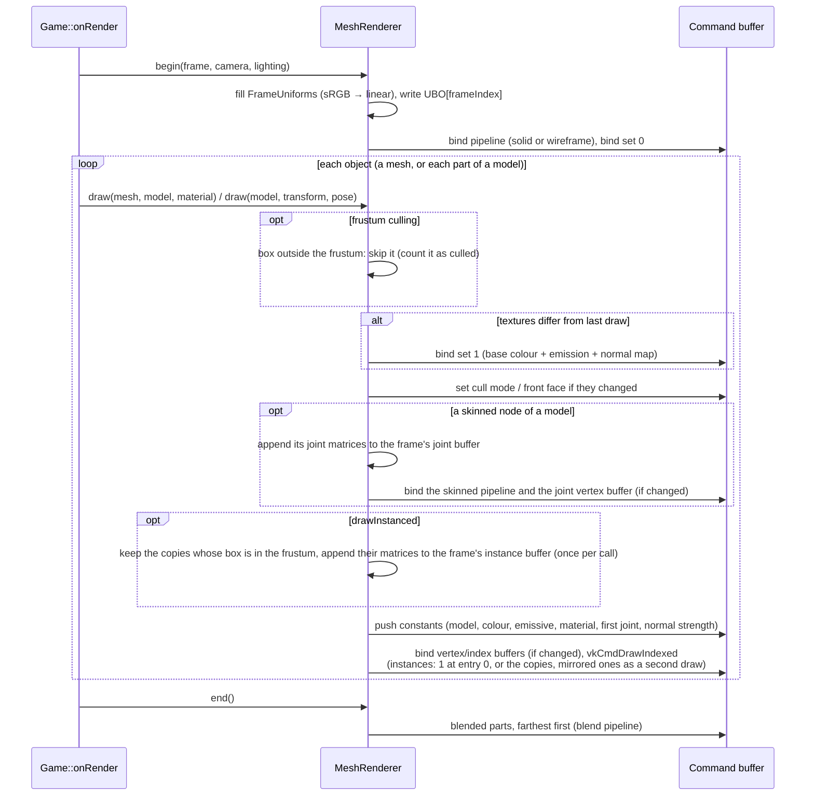

### 6.3 Pipeline state

| State | Solid pipeline | Wireframe pipeline | Shadow pipeline |
|---|---|---|---|
| Shaders | `mesh.vert` / `mesh.frag` | same | `shadow.vert` / `shadow.frag` |
| Polygon mode | `FILL` | `LINE` (only created if `fillModeNonSolid` is supported) | `FILL` |
| Culling | dynamic: back faces (none for double-sided), front = counter-clockwise (clockwise for mirrored nodes) | none | none (static) |
| Depth | test + write, `LESS` | test + write, `LESS` | test + write, `LESS`, into the shadow map's format |
| Colour | swapchain format | swapchain format | one attachment of format `UNDEFINED` (depth only) |
| Blending | opaque (a fourth pipeline, for Blend parts: alpha blending, no depth writes) | opaque | — |
| Vertex input | binding 0: position (`R32G32B32`), normal (`R32G32B32`), uv (`R32G32`), colour (`R32G32B32A32`), tangent (`R32G32B32A32`, location 6) | same | position, uv, colour (no normal or tangent) |

Each has a **skinned twin** (solid, blend, wireframe and shadow: eight in all), built from
the same `PipelineBuilder` with `mesh_skinned.vert` or `shadow_skinned.vert` and a second
vertex binding: joints (`R16G16B16A16_UINT`, location 4) and weights
(`R32G32B32A32_SFLOAT`, location 5). All eight share one pipeline layout (set 0, set 1,
the push constants), so the shadow pass binds the same sets and pushes the same
constants as the main pass, and switching between a rigid and a skinned pipeline keeps
the sets bound and the dynamic culling state. Instancing needs no pipelines of its own:
every vertex shader reads its copy's matrix from the instance buffer (§6.7).

Alpha-masked parts use `discard` in the fragment shader. Under SPIR-V 1.6 that compiles to
"demote to helper invocation", so `VulkanContext` enables the Vulkan 1.3 feature
`shaderDemoteToHelperInvocation` (required; every 1.3 driver has it).

### 6.4 Shading model (`mesh.frag`)

```
albedo   = texture(uv) · material colour · vertex colour      (discarded if alpha < cutoff)
N        = normalize(normal)   bent by the normal map, if any (§6.9);
           flipped for back faces, e.g. double-sided or wireframe
ambient  = mix(groundColour, skyColour, N.y · 0.5 + 0.5)      hemisphere light
sun      = sunlight(position, geometry normal)                 1 lit … 0 in shadow (§6.5)
diffuse  = sunColour · max(N·L, 0) · sun                        Lambert
shininess = 2^(10·(1 − roughness) + 1)                          roughness 0.5 → 64
strength  = 0.5 · (1 − roughness) · mix(1, 3, metallic)         roughness 0.5 → 0.25
specular = sunColour · mix(white, albedo, metallic) · strength · max(N·H, 0)^shininess · sun
colour   = albedo · (1 − 0.7·metallic) · (ambient + diffuse) + specular
           (unlit materials: colour = albedo)
colour  += emissive · emissionTexture(uv)                       glow, ignores lighting
fog      = 1 − exp(−(density · distance)²)                     exponential-squared
output   = mix(colour, fogColour, fog)                          linear, sRGB-encoded by the swapchain
```

The clear colour is set to the (linearised) fog colour, so distant geometry fades smoothly
into the background. Shared declarations live in `shaders/common.glsl`, included by both
stages with `GL_GOOGLE_include_directive`.

### 6.5 Shadows

One **shadow map** for the sun: a square depth image (2048² `D32_SFLOAT` by default,
16 MB; `D16_UNORM` if a GPU can't sample D32) holding, for each texel, the distance to the
first surface the sun meets.

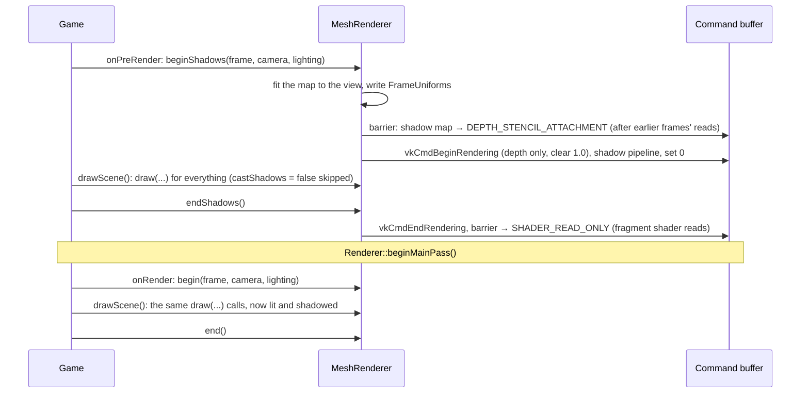

- **Same calls, two passes.** Between `beginShadows` and `endShadows`, `draw()` records
  into the shadow map with the shadow pipeline; otherwise into the main pass. A game keeps
  one `drawScene()` and calls it from both hooks. Skipping the shadow pass, or
  `shadows.enabled = false`, gives an unshadowed frame: `begin()` sees that no shadow pass
  ran for this `frameNumber` and sets the strength to 0, and the map's layout is always
  `SHADER_READ_ONLY_OPTIMAL` outside the pass (it is transitioned once at start-up).
- **Fitting.** The map covers the smallest sphere around the camera frustum's slice from
  the near plane to `distance`. Its radius depends only on the field of view, aspect
  ratio and distances, not on the camera's direction, so texels keep their size as the
  camera turns. The sphere's centre is moved in whole texels in the sun's view, so the
  texel grid stays fixed on the ground as the camera moves: no shimmering edges. This
  needs a still sun: when `sunDirection` changes, the grid turns with it and edges crawl
  (the demo's *Animate sun* is off by default for this reason). The
  orthographic projection reaches 100 m further towards the sun than the sphere
  (`kCasterReach`), so casters above the shadowed area (the drone) are in the map too.
- **Sampling.** A comparison sampler (`compareOp LESS_OR_EQUAL`, linear filtering, clamp
  to an opaque white border: outside the map counts as lit) gives a 2×2 filtered result
  per lookup; `mesh.frag` averages a 3×3 grid of lookups spaced `softness` texels apart.
  Shadows only reduce the sun's diffuse and specular light; ambient stays.
- **Bias.** `normalBias` texels push the lookup point out along the normal; `depthBias`
  texels are subtracted from its depth. Both are converted from texels to metres and
  depth units on the CPU. The shadow pipeline draws both faces with no culling, so open
  meshes cast correctly. There's no rasteriser depth bias (`PipelineBuilder` has none),
  so all bias is in the receiver.
- **Fade.** From 80 % of `distance` to `distance` (measured from the camera) the shadows
  fade out; beyond it `mesh.frag` skips the lookups.
- **Synchronisation.** One shadow map serves all frames in flight, like the depth buffer:
  the barrier before each shadow pass waits for earlier fragment-shader reads, and the
  one after it makes the writes visible to this frame's main pass.
- **Cost.** Every caster is drawn a second time (depth only, nine lookups per lit pixel
  in the main pass). In the demo: 48 shadow draws beside 49 main draws.

### 6.6 Skinning

A skinned mesh is bent on the GPU, the usual way (*linear blend skinning*):

1. **On the CPU, per draw.** `draw(model, transform, pose)` computes every node's matrix
   in model space for the pose (once per model draw), then for each skinned node
   `jointMatrices()`: `nodeMatrix[joint] · inverseBind[joint]` per joint. They are copied
   into this frame's **joint buffer** (a host-visible storage buffer per frame in flight,
   like the uniforms) after the ones already there; the index of the first goes in the
   push constants (`material.w`).
2. **On the GPU, per vertex.** `skin.glsl` blends the four matrices the vertex names by
   its weights; `mesh_skinned.vert` multiplies `object.model` (the model's `transform`) by
   the result and carries on exactly like `mesh.vert`, normal matrix included.
   `shadow_skinned.vert` does the same for the shadow pass, so shadows bend too.

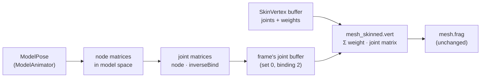

- The joint buffer holds `maxJoints` matrices (8192 by default: 512 KB per frame in
  flight); the shadow pass and the main pass both append, so a model drawn in both uses
  its joints twice (the soldier: 14 × 2). `jointsUsed()` reports the frame's total. When
  it's full, further skinned draws are skipped with one warning.
- It's reset where the per-frame texture sets are: in `beginShadows`, or in `begin` if the
  frame had no shadow pass.
- Blend parts of skinned meshes keep their joint offset until `end()` draws them; their
  distance for sorting uses their unbent bounds.
- Cost: four matrix reads and a blend per vertex, plus an `inverse()` for the normal
  matrix as in `mesh.vert`; on the CPU, one matrix per node and per joint per draw. The
  demo's skinned soldier is 5 draw calls (one per material) instead of the rigid gunner's
  19.

### 6.7 Instancing

Many copies of one mesh or model (a forest, a field of rocks, a ring of crates) in one draw
call per part, instead of one per copy:

1. **On the CPU, per call.** `drawInstanced(model, transforms, pose)` copies the matrices
   into this frame's **instance buffer** (a host-visible storage buffer per frame in
   flight, like the joint buffer), after the ones already there, mirrored copies (negative
   determinant) last. It computes the model's node matrices in model space once, for the
   shared pose.
2. **Per part.** Each primitive is drawn with `vkCmdDrawIndexed(..., instanceCount,
   firstInstance)`: the push constants hold the part's matrix within the model (identity
   for a mesh or a skinned part), `firstInstance` the index of the first copy's matrix.
   Mirrored copies are a second draw with the opposite front face.
3. **On the GPU, per vertex.** `instance.glsl`'s `instanceMatrix()` returns
   `instances[gl_InstanceIndex] · object.model` (in Vulkan, `gl_InstanceIndex` includes
   `firstInstance`). All four vertex shaders use it, so instancing works in the main pass,
   the shadow pass, wireframe and with skinning.

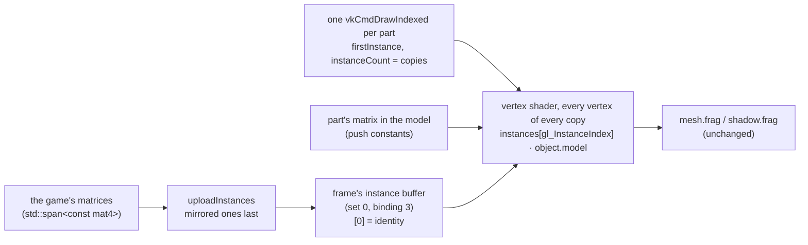

- **Single draws use entry 0**, which holds the identity matrix and is never overwritten:
  `draw()` passes `firstInstance = 0`, so the same shaders and pipelines draw both, and
  `draw()` costs one extra matrix read per vertex.
- The buffer holds `maxInstances` matrices (16384 by default: 1 MB per frame in flight);
  both passes append, so the demo's 812 copies use 1624 (plus entry 0). It's reset with the
  joint buffer. A call that doesn't fit is skipped with one warning.
- **Shared per call:** the material (or the model's materials) and the pose; a skinned
  model's joints are uploaded once for all its copies.
- **Blend parts** are queued one copy at a time, each with its own matrix
  (`instance · part`), and drawn in `end()` with the other see-through parts, farthest
  first.
- **Culling** keeps only the copies whose box is in view (§6.8): only those take room in
  the buffer.
- Cost: the matrices are written once per pass (64 bytes per copy); on the GPU, a matrix
  read and multiply per vertex. The demo's 800 trees are 2 draw calls per pass instead of
  1600.

### 6.8 Frustum culling

What the camera can't see needn't be drawn. Each pass has a `Frustum` (§3.3): `begin()`
takes the camera's (`camera.viewProjection()`), `beginShadows()` the shadow map's
(`shadowMatrix_`, a box reaching `kCasterReach` towards the sun, so tall things and the drone
outside the view still cast into it). Every draw is tested against it before anything is
bound or uploaded:

| Call | What is tested | Against |
|---|---|---|
| `draw(mesh, matrix, material)` | the mesh's box (`Mesh::boundsMin/Max`), placed by `matrix` | once |
| `draw(model, transform, pose)`, a rigid part | the primitive's box (`ModelPrimitive::bounds*`), placed by its node's matrix | per part, so a model half on screen draws only that half |
| `draw(model, ...)`, a skinned node | `Model::skinBounds` for this pose, placed by `transform` | per node, before its joints are uploaded |
| `drawInstanced(mesh, matrices, material)` | the mesh's box, placed by each matrix | per copy |
| `drawInstanced(model, transforms, pose)` | one box around the whole model in this pose (every part, skinned ones bent), placed by each matrix | per copy, before the matrices are uploaded |

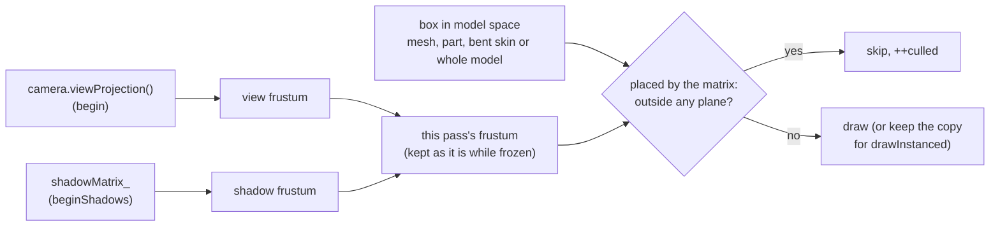

- **The test.** The box is placed by its matrix (a centre and three half-axes) and
  compared with each plane in turn: it's out if, for some plane, the centre is further
  outside than the box reaches. Exact for each plane; a box just outside a corner (outside
  the frustum but not wholly behind any one plane) is still drawn. Mirrored and scaled
  matrices work as they are.
- **Exactly the same picture.** Only what can't touch the screen (or the shadow map) is
  left out, so turning culling off changes nothing visible. The demo checks this pixel for
  pixel.
- **Skinned bounds** are conservative: the joints' boxes overlap and are joined into one
  upright box, a little larger than the bent mesh (about 0.17 m across the diagonal, for the
  soldier).
- **Blend parts** are culled with the rest, before they're queued for sorting.
- **Freezing** (`setCullingFrozen(true)`) keeps both frustums of that moment while the
  camera moves on: fly out and see exactly what was left out. Debug use only.
- **Counters:** `culled()` / `shadowCulled()` count the meshes, parts, skinned nodes and
  copies left out; `triangles()` / `shadowTriangles()` the triangles drawn.
- **The cost** is on the CPU: up to 6 plane tests per box, about 15 ns per box in an
  optimised build on a desktop CPU, so the demo's 812 copies take about 12 µs per pass.
  Without a spatial structure every object is still visited: for tens of thousands, cull
  groups (patches of forest, rooms) first.
- In the demo's forest, looking out from the clearing, about 700 of 812 copies are culled in
  the main pass and about 650 in the shadow pass: 17–24 thousand triangles drawn instead of
  135 thousand.

### 6.9 Normal maps

A normal map stores, per texel, which way the surface faces, relative to the surface: x
along the tangent (the way the texture's u runs), y along the bitangent (the way v runs,
**up** the image), z straight out. Bevels, grooves and grain catch the light without the
triangles to make them; the outline stays the mesh's.

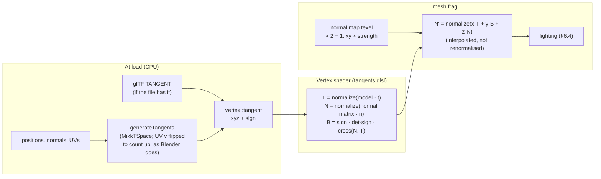

- **Tangents.** MikkTSpace answers per triangle corner; a vertex shared by corners that
  need different tangents (a UV seam the vertices didn't split, a mirrored half) is copied,
  never averaged, as MikkTSpace requires. Its V axis counts up the image, as in Blender:
  `getTexCoord` hands it `1 − v`. The result matches Blender's exported tangents exactly
  (NormalTangentMirrorTest: 15,720 corners, worst difference 0.0°, every sign the same).
- **The MikkTSpace pixel transform.** Per vertex the normal and tangent are made unit
  length and the bitangent rebuilt as `sign · cross(N, T)`; per pixel the three
  interpolated vectors are combined without renormalising them first. That's the inverse
  of what MikkTSpace-based bakers do, so baked maps show no seams.
- **Mirrored copies** (negative determinant) flip the bitangent's sign in the vertex
  shader, so a mirrored model's bumps still face the light correctly.
- **Convention:** OpenGL / glTF / Blender (green = up). A DirectX-style map (green = down)
  needs its green channel inverted.
- **Strength:** `normalScale` (glTF's `normalTexture.scale`) multiplies x and y before the
  normal is rebuilt; 0 or no texture, or a vertex without a tangent, uses the surface's
  own normal. `setNormalMaps(false)` turns all of them off.
- **Shadows** are looked up with the surface's own normal (the normal offset of §6.5), so
  the map doesn't move shadow edges.
- **Data, not colour:** normal maps are loaded linear (`TextureDesc::srgb = false`;
  `Model` does it for the textures its materials use as normal maps). Mipmaps average the
  directions, so a fine pattern looks softer from far away.
- **Cost:** the vertex grows from 48 to 64 bytes (every mesh), one texture read per pixel,
  a few multiplies; the shadow pass doesn't read it.
- **The demo** gives the crates a normal map (`assets/textures/crate_normal.png`, made by
  `tools/make_crate_normal.py` from the crate texture's layout): bevelled frame and brace,
  grooves between the planks, a little grain.

### 6.10 Morph targets

Blender's shape keys, glTF's morph targets: each one moves every vertex of a mesh by its own
offset (and turns its normal a little). A weight per target says how much of it to add, so
sliders can change a body's shape ("Belly" 0.7, "Shoulders" 0.3) or a face's expression. It
happens before skinning, in the mesh's own space, as glTF specifies, in both passes.

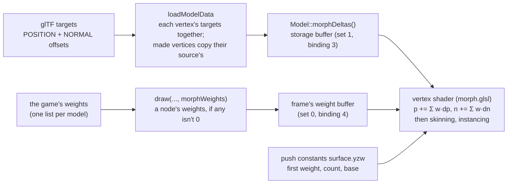

- **Storage.** `MorphDelta { vec3 position; vec3 normal; }` (24 bytes, six floats in the
  shader), all of a model's in one device-local storage buffer, laid out per vertex: vertex
  `v`'s offset for target `t` is entry `base + v * count + t`, where `v` is
  `gl_VertexIndex` (it includes the part's `vertexOffset`, so `base = morphFirst −
  vertexOffset · count` is pushed). A vertex's targets are side by side, so one vertex's
  reads are close together.
- **Per draw.** For each node of a morphed mesh, `draw` picks its weights (the game's, the
  file's for any missing), and if any isn't 0 writes them into the frame's weight buffer
  (like joints) and pushes where they start. All 0 (or no targets): the target count pushed
  is 0 and the shader skips the morph entirely, so unmorphed models cost one branch per
  vertex. Instanced copies share the weights, like the pose.
- **Per vertex** (`applyMorphs`), a loop over the targets: a weight of 0 skips its target
  (the same for every vertex of the draw, so the branch is cheap); the others add six
  floats each. The normal is renormalised after the normal matrix, as before.
- **Culling.** At load each target gets the box its offsets span. Per draw the reach of
  all targets at their weights (each box times its weight; a negative weight flips it) is
  added to each rigid part's box, or to every joint's box before `skinBounds` bends them:
  still conservative, so the picture is identical with culling on or off (checked).
- **Set 1** carries the offsets because it's already per draw and cached per frame: a
  morphed model's parts get their own sets (textures + its offsets); everything else binds
  a 24-byte empty buffer there. The vertex stage now reads 4 storage buffers (joints,
  instances, weights, offsets), exactly the minimum every Vulkan GPU allows
  (`maxPerStageDescriptorStorageBuffers` ≥ 4).
- **Not done:** tangent offsets (the tangent frame of a normal-mapped morphed mesh is the
  unmorphed one; fine for gentle shapes), morph animation channels (weights come from the
  game), more than one weight list per draw for meshes shared by two nodes in a pose.
- **Checked** (cloud container, 2026-11-19, lavapipe): Khronos AnimatedMorphCube,
  MorphPrimitivesTest and MorphStressTest (8 targets, negative weights), a test mesh with
  split tangents and flat shading, and the MakeHuman body (14,517 + 2,120 vertices, skinned,
  10 targets) posed with shadows, single and instanced: every picture identical, pixel for
  pixel, to the same model morphed on the CPU; with all weights 0, identical to the body
  without targets.

### 6.11 Text


- **Baking (load time).** `stbtt_PackFontRange` rasterises every character in the range into
  the smallest square atlas that fits (256 to 4096 px), with 2× horizontal oversampling for
  smoother sub-pixel placement. Coverage goes into the alpha channel of a white RGBA texture,
  so the ordinary sprite shader draws and tints text: no extra pipeline or shader.
- **Mipmaps and filtering.** Smooth fonts (`FontDesc::smooth`, the default) use linear
  filtering and mipmaps, so text drawn below the baked size stays clean. Pixel fonts use
  nearest filtering and should be drawn at whole multiples of their size.
- **Layout (draw time).** `drawText` decodes UTF-8, applies kerning between pairs, handles
  `'\n'`, and aligns each line left, centre or right of the given position, which is the
  **top** of the first line. Characters outside the baked range render as `?`.
- **Crisp HUD text.** With a 1:1 screen-space camera, `TextStyle::snapToPixel` rounds the
  start position and baselines to whole pixels.
- **Cost.** Text is just more quads in the batch; consecutive text and sprites from the same
  atlas share draw calls. The font keeps the `.ttf` data in memory for kerning lookups.

---

## 7. Coordinate systems and colour

**World space**: right-handed, **+Y up**, +X right, the default camera looks along **−Z**.
Units are arbitrary; the demo treats 1 unit as 1 metre.

**Winding**: front faces are **counter-clockwise** in object space. Vulkan's framebuffer has
+Y down, and `Camera3D::projection()` flips Y, which keeps counter-clockwise triangles
front-facing with `VK_FRONT_FACE_COUNTER_CLOCKWISE`.

**Transform chain**

```
clip = projection · view · model · position
view       = lookAt(position, position + forward, +Y)
projection = perspective(fovY, aspect, near, far) with [1][1] negated (Y flip),
             depth 0 at near plane, 1 at far plane
```

**Camera orientation**

```
forward = (cos(pitch)·cos(yaw), sin(pitch), cos(pitch)·sin(yaw))
right   = normalize(forward × +Y)
up      = right × forward
```

Pitch should be clamped just short of ±90° (the demo uses ±1.55 rad) to avoid the
`lookAt` singularity.

**Colour pipeline (linear workflow).**

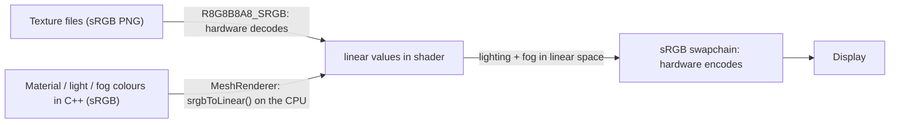

Rule of thumb: **author colours in sRGB** (as picked in an image editor); **lighting runs
in linear space**, which is what makes it look physically plausible. Data textures (normal
maps, roughness, masks) must use `TextureDesc::srgb = false`.

---

## 8. Build system

**CMake ≥ 3.22**, presets in `CMakePresets.json` (`debug`, `relwithdebinfo`, `release`,
`vs2022`, `vs2026`).

**Dependencies** are fetched by `cmake/Dependencies.cmake` with pinned versions:

| Library | Version | Use | Linked as |
|---|---|---|---|
| SDL3 | 3.4.16 | window, input, gamepads | static |
| Vulkan-Headers | SDK 1.4.350.0 | Vulkan types | headers |
| volk | SDK 1.4.350.0 | runtime Vulkan loader | compiled into `third_party` |
| VMA | 3.3.0 | GPU memory allocation | header (impl in `Implementations.cpp`) |
| GLM | 1.0.1 | vector/matrix math | headers |
| stb | pinned commit | image loading (stb_image), font rasterisation (stb_truetype) | header (impl in `Implementations.cpp`) |
| miniaudio | 0.11.23 | audio output, mixing, decoding (WAV/FLAC/MP3, OGG via its bundled stb_vorbis), 3D sound | header (impl in `audio/MiniaudioImpl.cpp`) |
| Dear ImGui | 1.92.9 | debug UI, with its SDL3 and Vulkan backends | static library `imgui` |
| nlohmann/json | 3.12.0 | JSON: Aseprite sprite sheets, settings and saves | header only |
| cgltf | 1.15 | glTF 2.0 parsing (`.gltf`, `.glb`) for `render3d::Model` | header (impl in `render3d/Model.cpp`; fetched by both projects so `Dependencies.cmake` stays identical, used by Game3D only) |
| MikkTSpace | pinned commit | tangents for normal maps (`render3d/Tangents.cpp`) | static library `mikktspace`; declared in Game3D's own `CMakeLists.txt`, not in the shared `Dependencies.cmake` |

Global definitions: `VK_NO_PROTOTYPES`, `GLM_FORCE_DEPTH_ZERO_TO_ONE`,
`GLM_FORCE_RADIANS`. On Linux, `third_party` also links `pthread`, `dl` and `m` for
miniaudio, which loads ALSA/PulseAudio/PipeWire/JACK at run time (no audio dev packages
needed to build).

**Shaders** (`cmake/Shaders.cmake`): every `shaders/*.vert|*.frag|*.comp` is compiled to
`<exe dir>/shaders/<name>.spv` with `glslc` or `glslangValidator` (from the Vulkan SDK or
system packages). If neither exists, glslang is downloaded and built from source
automatically. `*.glsl` files in the folder are treated as includes and trigger rebuilds.

**Output layout**: `build/<preset>/bin/<Config>/` contains the executable, `shaders/` and
`assets/` (re-synced on every build). `cmake --install` produces a distributable folder.

---

## 9. Error handling, logging and debugging

- **Philosophy: fail fast and loud.** Unrecoverable conditions call `core::fatal()`,
  which logs, shows a message box (useful for players: "No GPU with Vulkan 1.3 support")
  and aborts.
- `VK_CHECK(expr)` wraps Vulkan calls and reports the result name, the expression and
  file:line.
- **Validation layers** are enabled in Debug builds when installed; override with the
  environment variable `GAME_VALIDATION=0/1`. Messages of warning level and above are
  routed to the log.
- **Debug names** are attached to buffers, images and views via `VK_EXT_debug_utils`, so
  RenderDoc / Nsight / validation messages show readable names.
- **Testing aid:** `GAME_MAX_FRAMES=N` exits after N rendered frames (smoke tests, CI).
- **Audio problems are never fatal.** A missing device logs a warning and the game runs
  silently; a sound file that fails to load logs one warning per file and `play`
  returns an empty handle. `GAME_AUDIO=0` turns audio off entirely.

---

## 10. Platform notes

| Platform | Notes |
|---|---|
| Windows | Saves and settings in `%APPDATA%\<organization>\<application>\`. MSVC (VS 2022/2026), console in Debug, `WIN32` subsystem in the `release` preset (`GAME_WINDOWS_CONSOLE=OFF`). Vulkan SDK recommended for validation. |
| Linux | X11 and Wayland via SDL3 (dev packages needed at build time only). `$ORIGIN` rpath for shipping extra `.so` files. |
| Steam Deck | Saves in `~/.local/share/<organization>/<application>/` (Steam Cloud: Auto-Cloud root `LinuxXdgDataHome`). SteamOS + Mesa RADV (full Vulkan 1.3). 1280×800; controls exposed as a gamepad by Steam Input; borderless fullscreen under gamescope. Build in a container (distrobox) or the Steam Linux Runtime SDK for releases. |

---

## 11. Extending the framework

| You want to… | Where / how |
|---|---|
| Write your game | New `core::Game` subclass in `src/game/`, construct it in `main.cpp` |
| Add a shader | Drop `foo.vert` / `foo.frag` in `shaders/`, build a pipeline with `PipelineBuilder` using `core::shaderPath("foo.vert.spv")` |
| Add your own geometry | Fill `render3d::MeshData` (CCW triangles, normals, UVs) and construct a `Mesh` |
| Load models | `render3d::Model::load(gpu, path)` (glTF 2.0), drawn with `MeshRenderer::draw(model, transform, pose)` |
| Add a skinned character | Blender: mesh + Armature, *Ctrl+P > With Automatic Weights*, one Action per animation; export glTF with *Skinning* on and at most 4 influences per vertex. Load and draw it like any model; play its Actions with a `ModelAnimator` |
| Add bumps and detail with a normal map | Load it with `TextureDesc::srgb = false` and set `material.normalTexture` (the primitives have tangents; call `generateTangents(data)` on your own `MeshData`). From Blender, an image through a *Normal Map* node into the material's *Normal* input exports as glTF's normal texture, which `Model` uses (§6.9; tested with Khronos' sample files, not yet with a Blender export of yours) |
| Draw many copies (trees, rocks, crowds) | `meshes.drawInstanced(model, matrices)` or `drawInstanced(mesh, matrices, material)`: one draw call per part for all of them (§6.7); a bigger `maxInstances` for more than ~8000 copies with shadows |
| Skip work for things off screen | `render3d::Frustum(camera.viewProjection()).intersects(boundsMin, boundsMax, matrix)`, as `MeshRenderer` does for drawing (§6.8). For very large worlds, cull groups of objects (a grid of cells) before testing each one |
| Shape sliders (body shape, faces) | Shape keys in Blender, exported with glTF *Data > Shape Keys* on (the default); `findMorphTarget("Belly")` once, then pass a weight list (from `defaultMorphWeights()`) to `draw` (§6.10) |
| Draw something whose vertex shader moves vertices (wind, waves) | Make its mesh's box big enough for the movement, or culling may leave it out while part of it is on screen |
| Add a new renderer (skybox, particles) | New class in `render3d/` following `MeshRenderer`: own `Pipeline` with `renderer.depthFormat()`, per-frame buffers indexed by `frame.frameIndex` |
| Sharper or further shadows | Change `shadows.distance` and the constructor's `shadowMapSize`; for both at once, cascades: several maps for near-to-far slices of the view, fitted like `fitShadowMap` |
| Shadows from other lights | Spot light: a perspective version of the sun's map; point light: a cube map. Same pattern: a depth-only pass in `onPreRender`, sampled in `mesh.frag` |
| Render off-screen (post-processing, bloom, tone mapping) | Create an `Image` with `COLOR_ATTACHMENT \| SAMPLED` usage, render to it in `onPreRender`, sample it in the main pass |
| Change GPU features | Feature chain in `VulkanContext::createDevice()` |
| Upload data at runtime | `Buffer` with `CpuToGpu` per frame in flight, or `immediateSubmit` at load time |

---

## 12. Key design decisions

| Decision | Rationale | Trade-off |
|---|---|---|
| SDL3 as the platform layer | Best gamepad/Steam Deck support, X11 + Wayland | One external dependency in the core |
| Effects as our own miniaudio nodes, with parameters smoothed on the audio thread | One node per bus and per voice keeps the graph fixed; glides make every change click-free; the game thread never blocks | Effects are fixed (filters, echo, reverb), not a general effects rack; adding one means writing a node in `Effects.cpp` |
| miniaudio for audio (not SDL3 audio) | One file; decoding, mixing, groups, fades, streaming and 3D sound built in; picks the best backend on each OS | A second audio layer beside SDL; audio API is our own wrapper, not SDL's |
| Vulkan 1.3 baseline | Dynamic rendering + sync2 remove most boilerplate; supported by all current desktop drivers and the Deck | Excludes very old GPUs/drivers |
| volk instead of linking the loader | Friendly error when Vulkan is missing; faster device-level calls | Function pointers instead of prototypes |
| VMA for memory | Correct, efficient suballocation without writing an allocator | Third-party header |
| One descriptor set per texture | Binding a texture is one call; no caches that can go stale | One set per texture (cheap); not bindless |
| Forward rendering | Simplest path to correct lighting with one main light; works well on the Deck | Many dynamic lights need clustered/forward+ or deferred later |
| Per-object data in push constants (128 B, the guaranteed maximum) | No per-object buffers or descriptor updates; works on every GPU | One draw call per object or model part; `drawInstanced` covers many copies of one thing |
| Frustum culling inside `MeshRenderer`, per part and per copy, against each pass's own frustum | Every game gets it with no code; the shadow pass culls against the shadow map, so off-screen casters still cast; the instance buffer only holds visible copies; the picture is identical with it off | The CPU visits every object every pass (no hierarchy or grid); boxes, not tighter shapes; a vertex shader that moves vertices beyond the mesh's box would be culled too early |
| Instancing through a per-frame matrix buffer and `gl_InstanceIndex`, entry 0 the identity | No extra pipelines or vertex formats: the same four vertex shaders serve single and instanced draws, skinned or not, in both passes; the game passes plain matrices | Copies share material and pose (no per-copy colour yet); every single draw pays one matrix read per vertex; matrices are re-uploaded each pass even when they never change |
| Normal matrix computed in the vertex shader | Frees push-constant space for material values; correct under non-uniform scale | An `inverse()` per vertex (cheap for game-sized meshes) |
| glTF 2.0 via cgltf, one `Mesh` per model | The format Blender and asset stores export; cgltf is one small header; one vertex/index buffer per model means few binds | Whole model in memory |
| Morph targets on the GPU: offsets in a per-model storage buffer, weights per draw in a per-frame buffer, applied in the vertex shaders before skinning | No per-draw copies of the mesh; the same eight pipelines and vertex formats; skinning, instancing and shadows work with it unchanged; weights belong to the draw, so one `Model` shows many body shapes at once | Every vertex shader branches on the count (cheap); weights are re-uploaded each pass; tangent offsets ignored; the push constants are now completely full |
| Tangents in every `Vertex`, by MikkTSpace, the frame rebuilt the MikkTSpace way in the shaders | Normal maps baked in Blender (or any MikkTSpace baker, such as CharacterCreator's) line up with no seams; one vertex format for every mesh; mirrored UVs and mirrored copies work | 16 more bytes per vertex even for meshes without a normal map; vertices copied where tangents split; the push constants are now full |
| Per-instance `ModelPose` instead of mutable nodes | One loaded model, many copies each in its own pose (rotors at different angles); the `Model` stays read-only | The game keeps a pose per copy |
| Rigid-part animation (node TRS) first, skinning on top | Covers mechanical models and characters built from parts (the owner's mix-and-match style); bones are nodes too, so skinning reuses the same poses, animator and sockets | — |
| Linear blend skinning on the GPU, joint matrices in a per-frame storage buffer | The standard method, what glTF and Blender expect; no per-draw descriptor updates (an offset in the push constants picks the joints); shadows bend for free with a skinned shadow shader | Joints twist and lose volume at extreme bends ("candy wrapper" wrists); dual-quaternion skinning would fix that. The matrices are recomputed for each pass |
| Separate skinned pipelines rather than one shader with a branch | Rigid meshes keep their plain vertex format and shader; skinned data is a second vertex buffer only skinned models have | Eight pipelines instead of four; a rigid/skinned switch rebinds the pipeline |
| Animator rebuilds the whole pose each update | Simple and correct (no drift, procedural tweaks don't accumulate, blends include untouched nodes) | Work per node per update, fine for game-sized hierarchies |
| Third-person camera collision through a ray callback | The camera stays independent of how a game stores its level; the same `raycast*` shapes serve shooting and picking; no physics engine needed | The game lists its colliders; only simple shapes until triangle tests or a physics engine come in |
| Camera jumps in when blocked, eases out when clear | The player is never hidden behind a wall, and the camera doesn't jitter in and out past posts | A sudden cut when something passes between player and camera |
| Moments by time (`reached`) rather than named events | glTF has no animation events; times come straight from Blender's timeline | Times live in code; rename-safe events would need a side file |
| Single shared depth buffer | Saves memory; correct thanks to the per-frame barrier | Frames' depth work is serialised (negligible) |
| One shadow map, fitted to a sphere and moved in whole texels | Stable edges with no shimmering as the camera turns or moves; one pass, simple code; plenty for a few dozen metres around a third-person camera | Resolution is spread evenly over `distance` (3.5 cm per texel at 30 m): shadows far away or at your feet are no sharper than in between; cascades would fix that |
| The game draws its scene twice through the same `draw()` calls | One `drawScene()` serves both passes, so shadows can't get out of step with what's drawn; no scene graph needed | The game makes the calls twice (CPU work); `castShadows` per material is the only way to leave something out |
| Biases and softness in texels, applied in the receiver | Settings hold when the distance or map size changes; no `PipelineBuilder` change (it stays identical to Game2D's) | Normal-offset bias can let light leak at very thin geometry; tune per scene |
| Comparison sampler + 3×3 lookups | Hardware 2×2 filtering on every GPU; soft, stable edges for nine lookups | Constant softness (no contact hardening as in PCSS) |
| Blinn-Phong + hemisphere ambient + fog, driven by roughness/metallic | Small, readable shader that looks good immediately and uses glTF's material values | Not PBR (no image-based lighting, no energy conservation); replace when materials need it |
| Wait-idle on swapchain recreation | Simplest correct approach | Brief stall on resize only |
| Settings remembered by the framework, from the live systems | A game gets saved volume, fullscreen, vsync and controls with no code; nothing can drift out of step, because the file is written from what the window, renderer and audio engine actually are | Settings are saved at exit (or on `saveSettings()`), so a crash loses changes made since; the layout of the `video`/`audio`/`controls` keys is the framework's |
| JSON save files with atomic replace and a backup | Readable and hand-editable while developing; a crash or power cut mid-save can't destroy a save | Text is larger than binary and anyone can edit it (fine for single-player) |
| Game states on a stack above the `Game`, with changes applied next frame | Pause = push a state; the game needs no "if paused" checks; a state can safely pop itself; an existing game adopts states without restructuring | One frame of delay on every change; games that want screens as separate scenes put gameplay in a state too |
| Named input actions, with the raw `Input` still available | Rebinding, button prompts and gamepad support come for free; the help text can't go out of date; a press is buffered for fixed steps | Actions are looked up by string (a small map lookup per call); the wheel and cursor stay raw `Input` |
| Fixed-timestep simulation | Deterministic gameplay, frame-rate independent | Needs interpolation for smooth rendering |
| Dear ImGui for debug tools, in Debug builds only | The standard for in-engine tools: tiny code to write a panel, huge widget set, backends for SDL3 + Vulkan | Not meant for player-facing UI (the game's own HUD/menus use `render2d`) |
| Identical `core/`, `gfx/`, `audio/`, `debugui/` and `render2d/` in 2D and 3D | Each project stands alone and is easy to understand | Changes must be copied between projects (or factored into a shared library later) |

---

## 13. Known limitations and roadmap

- Models: no occlusion/metallic-roughness textures, KTX2/WebP images or Draco/meshopt
  compression yet; morph targets without tangent offsets or weight animations. Normal maps use the first UV map only; no parallax or
  detail maps. Skinning is linear blend, 4 joints per vertex.
  One animation plays at a time per animator (plus blends); layering (legs walking, arms
  firing) is up to the game, by combining two poses.
- One directional light only, so only the sun casts shadows. One shadow map (no
  cascades): shadows reach `distance` (30 m) and fade out there; Blend (see-through)
  parts cast none; constant softness. A moving sun makes shadow edges crawl; keep
  `sunDirection` still, or change it very slowly.
- Third-person camera: collision with simple shapes only (planes, spheres, boxes); it
  doesn't fade the player out when it moves in very close; no automatic swing behind a
  running player. No character controller (the demo keeps its player out of circles
  around obstacles on a flat ground).
- Not PBR (roughness and metallic shape a Blinn-Phong highlight; image-based lighting and
  a proper BRDF would be the upgrade).
- No anti-aliasing (MSAA, FXAA or TAA).
- Frustum culling tests every object every pass (no grid or tree to skip whole areas), and
  no occlusion culling (things hidden behind others are still drawn). Instanced copies
  share their material and pose (no per-copy colour or animation time).
- No skybox (the fog-coloured clear colour stands in for the sky).
- The debug UI uses one window (no ImGui docking or multi-viewport) and doesn't save its
  layout.
- Audio: one listener (no split-screen); music is one track at a time. One shared reverb (no
  per-zone reverbs mixed together). Occlusion is the game's decision: muffle a sound with
  `setLowPass(handle, hz)` when something blocks it.
- Game states: no built-in transitions (fades, slides) or menu widgets; the 2D demo's
  `Menu` (tutorial step 14) is a starting point. States are created in code, not loaded
  from data.
- Input actions: one gamepad (no local multiplayer yet); no chords or combos ("Ctrl+S",
  double-tap); the mouse wheel and cursor aren't bindable.
- Saves: no encryption, compression or cloud API (Steam Auto-Cloud can sync the folder
  without code); no automatic migration between `version`s; windowed size and position
  aren't remembered.
- No deferred resource destruction; destroy GPU objects only when idle (see §4).
- Single queue for graphics/transfer; uploads are blocking (`immediateSubmit`).
